# Building Your Own Servers from Scratch: Comprehensive Engineering Research & Implementation Report

---

## Executive Summary

Building a server infrastructure from scratch represents one of the most foundational and demanding undertakings in computer science and systems engineering. The domain spans two tightly coupled, symbiotic disciplines:

1. **Software Server Engineering (Protocols & Systems Programming):** Writing network servers from raw operating system primitives upward—implementing protocol state machines (HTTP/1.1, HTTP/2, HTTP/3, WebSockets, Redis RESP, DNS), designing high-concurrency event loops (Reactor, Proactor, `epoll`, `kqueue`, `io_uring`), and optimizing kernel-to-userspace transitions to conquer the **C10K** and **C10M** concurrency frontiers.
2. **Infrastructure, Distributed Systems & Physical Data Center Engineering:** Architecting, assembling, hardening, routing, and orchestrating production-grade bare-metal server infrastructure capable of replacing public cloud services. This spans data center power delivery (2N UPS, ATS, diesel generation, PUE optimization), public internet routing (Autonomous System Numbers, BGP multihoming, RPKI, EVPN-VXLAN fabrics), bare-metal Kubernetes automation (PXE/iPXE, GitOps, MetalLB, Cilium eBPF), distributed consensus (Raft, Paxos, quorum, fencing), database durability (WAL, PITR, replication lag, idempotency), hardware firmware resiliency (NIST SP 800-193, TPM 2.0, Secure Boot, DMTF Redfish), zero-trust machine identity (SPIFFE/SPIRE, HSMs, post-quantum cryptography), and Total Cost of Ownership (TCO) financial modeling.

This report compiles an exhaustive, research-grade blueprint covering theoretical models, operating system internals, protocol specifications, benchmarking comparisons, architectural diagrams, concrete code implementations, hardware guides, and production deployment roadmaps.

---

## Table of Contents

- [Building Your Own Servers from Scratch: Comprehensive Engineering Research \& Implementation Report](#building-your-own-servers-from-scratch-comprehensive-engineering-research--implementation-report)
  - [Executive Summary](#executive-summary)
  - [Table of Contents](#table-of-contents)
  - [Part I: Systems Programming, Protocols \& Single-Node Infrastructure](#part-i-systems-programming-protocols--single-node-infrastructure)
    - [1. Software Architecture: Sockets, Concurrency \& Low-Level I/O](#1-software-architecture-sockets-concurrency--low-level-io)
    - [2. Protocol Engineering from Scratch](#2-protocol-engineering-from-scratch)
    - [3. OS Kernel \& TCP/IP Stack Performance Tuning](#3-os-kernel--tcpip-stack-performance-tuning)
    - [4. Hardware \& Physical Infrastructure Foundations](#4-hardware--physical-infrastructure-foundations)
    - [5. Production-Grade Reference Implementations](#5-production-grade-reference-implementations)
    - [6. Benchmarking, Load Testing \& Tooling](#6-benchmarking-load-testing--tooling)
    - [7. Modern Protocols: QUIC, HTTP/3, TLS 1.3 \& Advanced DNS](#7-modern-protocols-quic-http3-tls-13--advanced-dns)
    - [8. Deep Linux Kernel Engineering \& Hardware-Aware Performance](#8-deep-linux-kernel-engineering--hardware-aware-performance)
    - [9. Enterprise Hardware Architecture \& Component Engineering](#9-enterprise-hardware-architecture--component-engineering)
    - [10. Data Center Facilities, Power, Cooling \& Physical Security](#10-data-center-facilities-power-cooling--physical-security)
    - [11. Public Internet Infrastructure, Autonomous Systems, BGP \& Edge Routing](#11-public-internet-infrastructure-autonomous-systems-bgp--edge-routing)
    - [12. Bare-Metal Automation, Machine Provisioning \& Kubernetes](#12-bare-metal-automation-machine-provisioning--kubernetes)
    - [13. Distributed Storage, Consensus Algorithms \& Database Durability](#13-distributed-storage-consensus-algorithms--database-durability)
    - [14. High Availability, Cluster Quorum \& Disaster Recovery](#14-high-availability-cluster-quorum--disaster-recovery)
    - [15. Zero-Trust Security, Firmware Protection \& Compliance](#15-zero-trust-security-firmware-protection--compliance)
    - [16. Modern Observability, Distributed Tracing \& Site Reliability Engineering](#16-modern-observability-distributed-tracing--site-reliability-engineering)
    - [17. Infrastructure Financial Engineering: Total Cost of Ownership (TCO) \& Cloud Arbitrage](#17-infrastructure-financial-engineering-total-cost-of-ownership-tco--cloud-arbitrage)
    - [18. Testing, Verification, Fault Injection \& Production Acceptance](#18-testing-verification-fault-injection--production-acceptance)
    - [19. End-to-End Reference Implementations \& Deployment Roadmaps](#19-end-to-end-reference-implementations--deployment-roadmaps)
    - [20. Primary Bibliography \& Foundational Standards](#20-primary-bibliography--foundational-standards)
  - [Part II: Advanced Self-Hosted Infrastructure Platform Engineering](#part-ii-advanced-self-hosted-infrastructure-platform-engineering)
    - [21. Server Fleet Management, Asset Inventory \& Redfish Automation](#21-server-fleet-management-asset-inventory--redfish-automation)
    - [22. Building a Private Cloud from Bare Metal: AWS-Equivalent Services](#22-building-a-private-cloud-from-bare-metal-aws-equivalent-services)
    - [23. Advanced Data Center Networking: IPv6 \& EVPN-VXLAN Fabrics](#23-advanced-data-center-networking-ipv6--evpn-vxlan-fabrics)
    - [24. Hardware Lifecycle, Firmware Upgrades \& Automated Server Recovery](#24-hardware-lifecycle-firmware-upgrades--automated-server-recovery)
    - [25. Cryptographic Infrastructure, HSMs, Encryption \& Machine Identity](#25-cryptographic-infrastructure-hsms-encryption--machine-identity)
    - [26. Multi-Data-Center Architecture \& Geographic Disaster Recovery](#26-multi-data-center-architecture--geographic-disaster-recovery)
    - [27. Advanced Database Engineering, Transactional Consistency \& Data Integrity](#27-advanced-database-engineering-transactional-consistency--data-integrity)
    - [28. Capacity Forecasting, Workload Placement \& Resource Scheduling](#28-capacity-forecasting-workload-placement--resource-scheduling)
    - [29. Immutable Infrastructure, CI/CD \& Secure Supply Chains](#29-immutable-infrastructure-cicd--secure-supply-chains)
    - [30. Advanced Server Benchmarking, Profiling \& Performance Economics](#30-advanced-server-benchmarking-profiling--performance-economics)
    - [31. AI \& GPU Server Infrastructure, Distributed Training \& Inference](#31-ai--gpu-server-infrastructure-distributed-training--inference)
    - [32. Time Synchronization, Precision Clocks \& Distributed Event Ordering](#32-time-synchronization-precision-clocks--distributed-event-ordering)
    - [33. Cybersecurity Operations, Incident Response \& Digital Forensics](#33-cybersecurity-operations-incident-response--digital-forensics)
    - [34. Infrastructure Governance, Vendor Contracts, Legal Obligations \& Compliance](#34-infrastructure-governance-vendor-contracts-legal-obligations--compliance)
    - [35. Cloud-to-Bare-Metal Migration \& Cutover Engineering](#35-cloud-to-bare-metal-migration--cutover-engineering)
    - [36. Production Implementation, Acceptance Framework \& Verification Drills](#36-production-implementation-acceptance-framework--verification-drills)
    - [37. Master Bibliography \& Authoritative Specifications](#37-master-bibliography--authoritative-specifications)

---

## Part I: Systems Programming, Protocols & Single-Node Infrastructure

---

### 1. Software Architecture: Sockets, Concurrency & Low-Level I/O

#### 1.1 The POSIX Socket Abstraction & System Call Lifecycle

At the operating system kernel level, network communication is mediated through file descriptors (FDs) pointing to socket inodes in kernel memory. In Unix and Linux systems, the Berkeley Sockets API defines the system call interface between userspace applications and the transport-layer network subsystem.

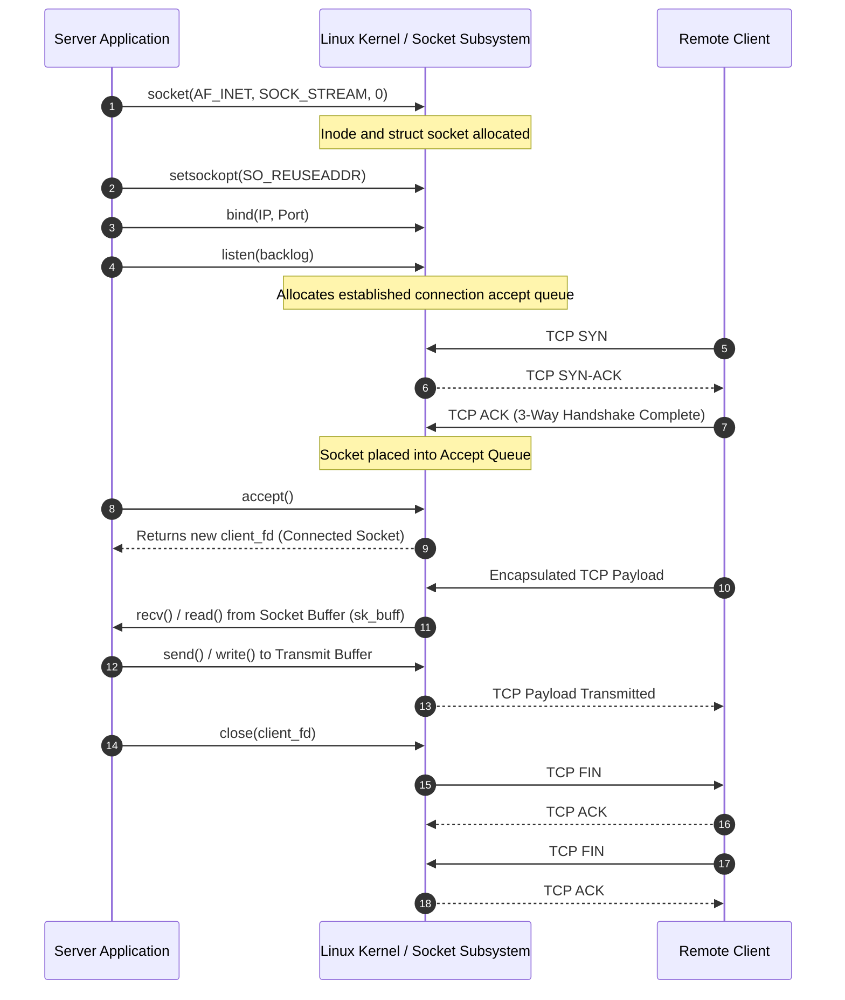

1. **`socket(domain, type, protocol)`**: Allocates an endpoint. `AF_INET` or `AF_INET6` specifies the address family (IPv4 or IPv6), while `SOCK_STREAM` requests reliable, byte-stream TCP (versus `SOCK_DGRAM` for datagram UDP).
2. **`setsockopt(fd, SOL_SOCKET, SO_REUSEADDR, ...)`**: Bypasses the socket `TIME_WAIT` lock, allowing immediate re-binding of a local port following process termination.
3. **`bind(fd, sockaddr, addrlen)`**: Binds the allocated socket file descriptor to a specific local network interface IP and TCP port.
4. **`listen(fd, backlog)`**: Transitions the socket from active to passive mode. **Critical OS distinction:** In modern Linux kernels (since version 2.2), `backlog` governs strictly the maximum length of the queue of **completely established sockets waiting to be accepted** via `accept()`. Half-open connections (those that have sent a `SYN` and await the final handshake `ACK`) are tracked separately in the SYN queue, whose size is bounded by `/proc/sys/net/ipv4/tcp_max_syn_backlog`.
5. **`accept(fd, sockaddr, addrlen)`**: Pops the first completed connection off the accept queue and creates a brand-new connected file descriptor dedicated to that specific client session, preserving the original listening socket for incoming handshakes.
6. **`recv()` / `read()` and `send()` / `write()`**: Exchanges raw byte streams between userspace buffers and kernel socket ring buffers (`sk_buff`).
7. **`close(fd)`**: Releases the userspace file descriptor reference and decrements the kernel inode reference counter, triggering the four-way TCP connection teardown (`FIN` $\to$ `ACK` $\to$ `FIN` $\to$ `ACK`).

#### 1.2 Concurrency Models & Evolution

Handling multiple concurrent client connections has evolved across distinct architectural generations:

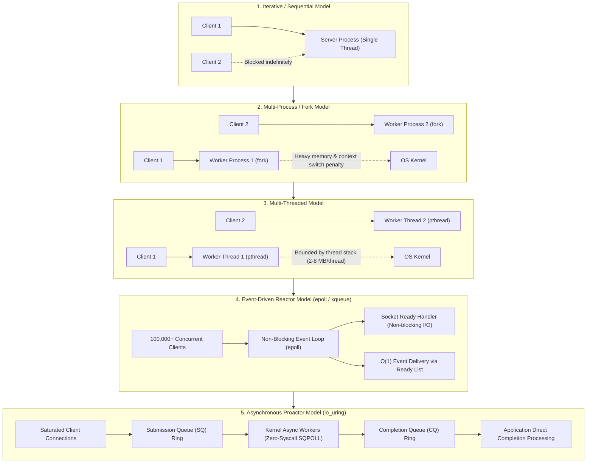

##### Determinants of Real-World Concurrency Capacity
Maximum concurrent connections are governed by kernel and hardware constraints rather than static software limits:
- **Available Physical RAM:** Every open TCP connection allocates kernel memory structures: `struct socket`, `struct sock`, and receive/transmit buffers (`tcp_rmem`, `tcp_wmem`). A typical idle Linux TCP socket consumes between 3 KB and 10 KB of kernel RAM. 1 million idle connections therefore require approximately 3 GB to 10 GB of kernel memory alone.
- **File Descriptor Limits:** Enforced globally by `fs.file-max` and per-process by `RLIMIT_NOFILE` (`ulimit -n`).
- **Ephemeral Port Exhaustion:** When initiating outbound connections or reverse proxying, client-side IP-port tuples are limited to the range defined in `net.ipv4.ip_local_port_range` (up to ~64,000 local ports per target IP).
- **Network Interface Queue & Interrupt Limits:** Saturated ring buffers on network interfaces drop frames if CPU cores fail to drain packets fast enough.

#### 1.3 Deep Dive: I/O Multiplexing & Scalability Limits

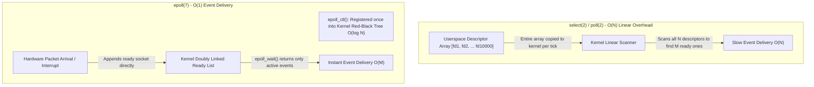

##### Algorithmic Complexity Nuances of `epoll(7)`
1. **Interest List Registration (`epoll_ctl` with `EPOLL_CTL_ADD` / `MOD` / `DEL`):** $\mathcal{O}(\log N)$, where $N$ is the total number of monitored file descriptors. The kernel maintains the interest set in a **Red-Black Tree** to allow efficient insertion, lookup, and deletion.
2. **Event Delivery (`epoll_wait`):** $\mathcal{O}(M)$, where $M$ is the number of **ready events** transferred to the userspace event array. Network device drivers append ready sockets to an in-kernel doubly linked **ready list**. `epoll_wait()` extracts items from this list without scanning the $N - M$ idle sockets.
3. **Userspace Processing:** $\mathcal{O}(M)$ iteration over the returned ready events.

##### `io_uring`: Mechanics and the Conditional Zero-Syscall Model
Linux `io_uring` bypasses readiness polling by providing shared-memory ring buffers between userspace and the kernel:
- **Submission Queue (SQ):** Userspace writes I/O operation descriptors (`struct io_uring_sqe`) without invoking a system call.
- **Completion Queue (CQ):** The kernel writes operation results (`struct io_uring_cqe`) when completed.

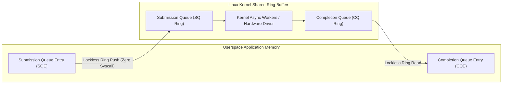

**The SQPOLL Wakeup Reality:** Under `IORING_SETUP_SQPOLL`, a dedicated kernel thread polls the Submission Queue, eliminating system calls entirely under continuous load. However, if the submission ring stays idle longer than `sq_thread_idle` milliseconds, the kernel thread enters sleep mode and sets the flag `IORING_SQ_NEED_WAKEUP` in the ring flags. When this flag is set, userspace **must** issue a system call (`io_uring_enter()` with `IORING_ENTER_SQ_WAKEUP`) to awaken the kernel thread. Zero-syscall execution is therefore an operational state under sustained load, not an unconditional guarantee.

#### 1.4 The Reactor and Proactor Architectural Patterns

```mermaid
flowchart TD
    subgraph Reactor["Reactor Pattern (Readiness-Based - e.g., Redis, Nginx, Node.js)"]
        R_Client["Connected Clients"] --> R_Demux["Demultiplexer (epoll_wait)"]
        R_Demux -->|"Notifies: Socket 42 is ready to read"| R_Disp["Dispatcher"]
        R_Disp --> R_Hand["Application Handler"]
        R_Hand -->|"Application explicitly issues read() syscall"| R_Sock["Socket Buffer"]
    end

    subgraph Proactor["Proactor Pattern (Completion-Based - e.g., Windows IOCP, io_uring)"]
        P_Client["Connected Clients"] --> P_Kernel["Async Kernel Processor (io_uring)"]
        P_Kernel -->|"Kernel automatically reads data into userspace buffer"| P_Ring["Completion Event"]
        P_Ring -->|"Notifies: 1024 bytes already in userspace buffer"| P_Hand["Proactor Completion Handler"]
    end
```

- **Reactor:** Used by Redis, Nginx, Node.js (`libuv`), and Netty. The demultiplexer signals when a descriptor is ready for I/O; the application code performs the actual read or write operation.
- **Proactor:** Used by Windows IOCP and Linux `io_uring`. The application initiates an asynchronous operation and passes a target buffer; the kernel completes the data transfer into userspace memory before notifying the event loop.

---

### 2. Protocol Engineering from Scratch

#### 2.1 HTTP/1.1 State Machine & RFC 9112 Framing Invariants

An HTTP/1.1 server operates over an unstructured TCP byte stream. The parser must reconstruct application-layer messages while strictly upholding RFC 9112 to prevent HTTP Request Smuggling and header injection vulnerabilities.

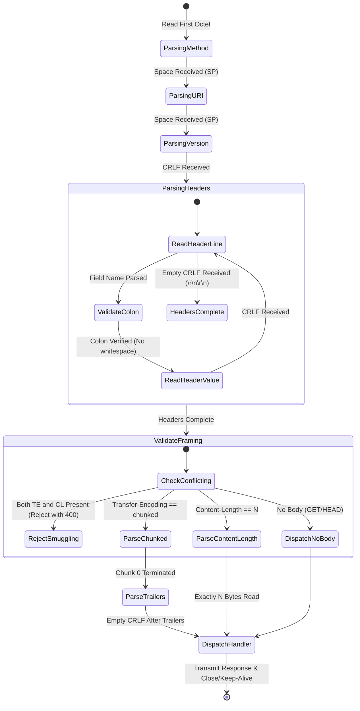

##### RFC 9112 Critical Framing Invariants
1. **Conflicting Framing Detection:** If a request contains both a `Transfer-Encoding` header and a `Content-Length` header, it poses a severe HTTP request smuggling vector. RFC 9112 Section 6.3 specifies that the server MUST either treat `Transfer-Encoding` as overriding `Content-Length` or reject the message with a `400 (Bad Request)` status code.
2. **Whitespace Prohibitions:** No whitespace is permitted between the header field-name and colon (`Field-Name : Value` is invalid and MUST be rejected with `400`).
3. **Repeated Header Fields (RFC 9112 Section 5.3):** A field value may consist of a comma-separated list of values. If the same field name is received multiple times, the parser must concatenate them with a comma separator: `Value1, Value2`. Overwriting previous occurrences silently corrupts request semantics.
4. **Chunked Body Trailers:** After the terminating `0\r\n` chunk, clients may transmit optional trailing headers (trailers) ended by `\r\n`. Parsers must consume and validate trailers.
5. **Bound Enforcement:** Parsers must enforce hard upper bounds on request-line length (8192 bytes), header field sizes, header counts, and payload sizes.

#### 2.2 In-Memory Data Store (Redis Clone with RESP)

##### Architectural Distinction: Toy Implementation vs. Production Redis
A pedagogical in-memory dictionary demonstrates the RESP protocol and non-blocking socket handling. However, a production Redis engine requires significantly more infrastructure:
- **Persistence:** Append-Only File (AOF) with `fsync` policies (`everysec`, `always`) and background child-process snapshotting via `fork()` (RDB).
- **Eviction Policies:** Constant-time sampling algorithms implementing LRU (Least Recently Used) or LFU (Least Frequently Used) when `maxmemory` is reached.
- **Replication & Consensus:** Async and semi-sync replication streams to replicas, plus Redis Sentinel or Redis Cluster gossip protocols for automated failover.

##### RESP (REdis Serialization Protocol) Specification
- **Simple Strings:** Begins with `+`, terminated by `\r\n` (e.g., `+OK\r\n`).
- **Errors:** Begins with `-`, terminated by `\r\n` (e.g., `-ERR unknown command\r\n`).
- **Integers:** Begins with `:`, terminated by `\r\n` (e.g., `:1000\r\n`).
- **Bulk Strings:** Begins with `$<length>\r\n<data>\r\n` (e.g., `$4\r\nECHO\r\n`). Null bulk strings are represented as `$-1\r\n`.
- **Arrays:** Begins with `*<count>\r\n<element_1>...<element_n>` (e.g., `*2\r\n$3\r\nGET\r\n$4\r\nuser\r\n`).

#### 2.3 WebSocket Server from Scratch (RFC 6455)

The WebSocket protocol establishes bidirectional full-duplex communication over a persistent TCP stream by upgrading an existing HTTP/1.1 connection.

##### Cryptographic Handshake Calculation
1. Extract the `Sec-WebSocket-Key` value.
2. Concatenate the RFC 6455 magic GUID: `"258EAFA5-E914-47DA-95CA-C5AB0DC85B11"`.
   $$\text{Input String} = \text{Key} + \text{"258EAFA5-E914-47DA-95CA-C5AB0DC85B11"}$$
3. Compute the **SHA-1 hash** of this string.
4. Encode the resulting 20-byte hash into **Base64**.
5. Return HTTP `101 Switching Protocols` with `Sec-WebSocket-Accept`.

##### Frame Decoding and XOR Unmasking
- **Masking Enforcement:** Every frame from client to server **MUST** have the MASK bit set to 1. If an unmasked frame arrives, the server MUST terminate the connection immediately (RFC 6455 Section 5.1).
- **Unmasking Algorithm:**
  $$\text{PayloadByte}[i] = \text{MaskedByte}[i] \oplus \text{MaskingKey}[i \pmod 4]$$

#### 2.4 UDP DNS Server Implementation & Wire Format

- **Label Compression:** Domain names are stored as sequences of length-prefixed octets (e.g., `\x03www\x07example\x03com\x00`).
- **Pointer Security:** When the top two bits of a length byte are set (`11` or `0xC0`), the remaining 14 bits represent an offset pointer into the message buffer. **Security critical:** Recursive parsers must validate offsets to prevent pointer loops (circular references designed to induce stack overflow or infinite loops) and out-of-bounds reads.
- **TCP Fallback:** If a UDP response exceeds the maximum payload size (512 bytes, or larger with EDNS0), the server sets the Truncation flag (`TC = 1`). Compliant clients must then re-issue the query over TCP port 53.

---

### 3. OS Kernel & TCP/IP Stack Performance Tuning

Applying a single universal kernel configuration indiscriminately across all servers causes severe performance degradation. Kernel tuning must be divided into **workload-specific performance profiles**.

#### Profile A: High-Throughput Edge / Web Gateway
Optimized for massive concurrent connection counts, rapid socket recycling, and high ingress throughput:
```ini
# /etc/sysctl.d/99-profile-edge-gateway.conf
fs.file-max = 2097152
net.core.somaxconn = 65535
net.core.netdev_max_backlog = 65536
net.ipv4.tcp_max_syn_backlog = 65535
net.ipv4.tcp_syncookies = 1
net.ipv4.tcp_tw_reuse = 1
net.ipv4.tcp_fin_timeout = 15
net.ipv4.ip_local_port_range = 1024 65535
net.ipv4.tcp_rmem = 4096 87380 16777216
net.ipv4.tcp_wmem = 4096 65536 16777216
net.core.default_qdisc = fq
net.ipv4.tcp_congestion_control = bbr
```

#### Profile B: High-Performance Database (PostgreSQL / Redis)
Optimized for low disk latency, predictable page flushing, memory locality, and zero swap thrashing:
```ini
# /etc/sysctl.d/99-profile-database.conf
vm.swappiness = 1
vm.dirty_background_ratio = 5
vm.dirty_ratio = 10
vm.zone_reclaim_mode = 0
kernel.numa_balancing = 0
vm.overcommit_memory = 2
vm.overcommit_ratio = 80
# Reserve memory for HugePages
vm.nr_hugepages = 16384
```

#### Profile C: Low-Latency High-Frequency Network Gateway
Optimized for sub-microsecond packet latency by eliminating kernel interrupts and CPU power state transitions:
```ini
# /etc/sysctl.d/99-profile-low-latency.conf
net.core.busy_poll = 50
net.core.busy_read = 50
net.ipv4.tcp_fastopen = 3
net.ipv4.tcp_low_latency = 1
net.ipv4.tcp_timestamps = 0
```
Kernel boot command line parameters for low latency:
```bash
# Append to GRUB_CMDLINE_LINUX:
# isolcpus=2-15 nohz_full=2-15 rcu_nocbs=2-15 intel_idle.max_cstate=0 processor.max_cstate=0
```

---

### 4. Hardware & Physical Infrastructure Foundations

#### 4.1 Enterprise Server Silicon & Component Selection

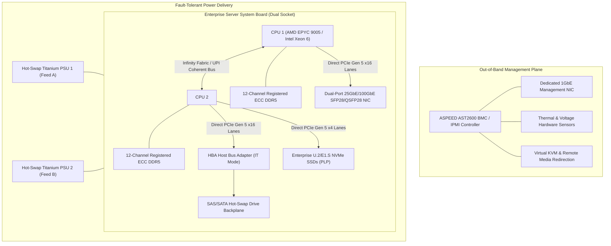

1. **Server Silicon Platforms:** Enterprise rackmount servers (e.g., Dell PowerEdge, HPE ProLiant, Supermicro SuperServer) offer server-grade silicon (AMD EPYC, Intel Xeon) featuring 8 to 12 DDR5 memory channels per socket, direct PCIe Gen 5 lanes without desktop chipset bottlenecks, and hardware-level virtualization extensions. (Note: Dell Precision and HP Z are desktop workstations, not rackmount server families).
2. **Registered ECC (RDIMM) Memory:** Protects against silent data corruption from single-bit errors caused by background cosmic radiation. ECC automatically corrects single-bit flips and safely halts the operating system on multi-bit parity errors to prevent data poisoning.
3. **Dedicated BMC / IPMI Controller:** An autonomous microcontroller (ASPEED AST2600) with its own dedicated Out-of-Band (OOB) Ethernet port. It runs independent firmware allowing remote console redirection (vKVM), hardware sensor telemetry, and power cycling even when the host OS is completely unresponsive.

#### 4.2 Operating Systems and Hypervisors

- **Type-1 Hypervisors (Bare Metal):** Systems such as **Proxmox VE** (Debian-based with KVM and LXC) or **XCP-ng** interact directly with physical hardware. They provide virtualization, clustered management, live storage migration, and fine-grained resource limits.
- **Minimalist Linux Distributions:** For bare-metal container hosts or dedicated appliances, **Debian Minimal**, **Ubuntu Server**, or **Alpine Linux** (musl libc, < 10 MB base footprint) reduce the Common Vulnerabilities and Exposures (CVE) attack surface and remove desktop background daemons.

#### 4.3 Storage Subsystems: OpenZFS Mechanics & Resiliency

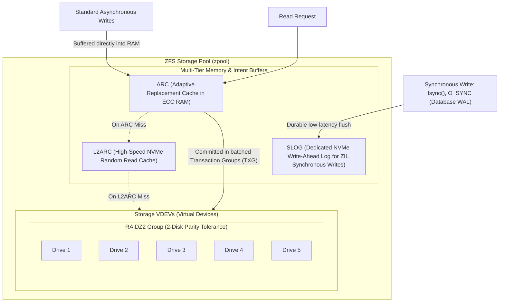

##### Crucial OpenZFS Distinctions
1. **The SLOG (Separate Intent Log) is NOT a General Write Cache:** Ordinary asynchronous writes do not traverse the SLOG; they are collected directly in system RAM (ARC / dirty cache) and committed to the main pool during periodic Transaction Group (TXG) flushes (typically every 5 seconds). The SLOG exists exclusively to serve the **ZFS Intent Log (ZIL)**. It provides a durable write-ahead log for **synchronous writes** (calls requesting `O_SYNC` or `fsync()`, such as database WALs) so that the application receives write confirmation without waiting for the next full TXG flush.
2. **Silent Corruption Detection vs. Automatic Repair:** ZFS computes cryptographic checksums (Fletcher4 or SHA-256) on every block read. If data corruption or bitrot occurs, ZFS detects it immediately. However, **automatic self-healing is possible only if redundancy exists** (via mirrors, RAIDZ1/2/3, or `copies=2+`). On a non-redundant single-disk pool, ZFS can only report an I/O error (`EIO`); it cannot repair the corrupted block.

#### 4.4 Secure Networking, Ingress & Zero Trust Overlays

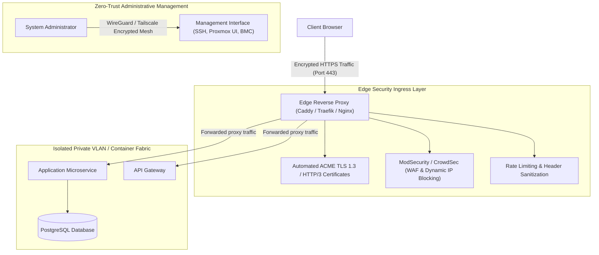

---

### 5. Production-Grade Reference Implementations

#### Blueprint A: Robust C Non-Blocking TCP Echo Server with `epoll` & Output Buffering

This implementation resolves edge-triggered concurrency pitfalls: explicit output buffer backpressure (removing `EPOLLIN` when write buffers are full), half-close detection (`EPOLLRDHUP`), elimination of use-after-free paths, and non-blocking accept loops.

```c
#include <stdio.h>
#include <stdlib.h>
#include <string.h>
#include <unistd.h>
#include <fcntl.h>
#include <errno.h>
#include <sys/socket.h>
#include <netinet/in.h>
#include <sys/epoll.h>

#define MAX_EVENTS 64
#define BUFFER_CAPACITY (16 * 1024)
#define READ_CHUNK 4096
#define PORT 8080

typedef struct {
    int fd;
    char write_buf[BUFFER_CAPACITY];
    size_t write_len;
    size_t write_offset;
    int read_disabled;
} client_state_t;

int set_nonblocking(int fd) {
    int flags = fcntl(fd, F_GETFL, 0);
    if (flags == -1) return -1;
    return fcntl(fd, F_SETFL, flags | O_NONBLOCK);
}

void free_client(int epoll_fd, client_state_t *client) {
    if (!client) return;
    epoll_ctl(epoll_fd, EPOLL_CTL_DEL, client->fd, NULL);
    close(client->fd);
    free(client);
}

void update_epoll_flags(int epoll_fd, client_state_t *client) {
    struct epoll_event ev;
    memset(&ev, 0, sizeof(ev));
    ev.events = EPOLLET | EPOLLRDHUP;
    if (!client->read_disabled) {
        ev.events |= EPOLLIN;
    }
    if (client->write_len > client->write_offset) {
        ev.events |= EPOLLOUT;
    }
    ev.data.ptr = client;
    epoll_ctl(epoll_fd, EPOLL_CTL_MOD, client->fd, &ev);
}

int main() {
    int listen_fd = socket(AF_INET, SOCK_STREAM, 0);
    if (listen_fd < 0) { perror("socket"); exit(1); }

    int opt = 1;
    setsockopt(listen_fd, SOL_SOCKET, SO_REUSEADDR, &opt, sizeof(opt));

    struct sockaddr_in server_addr;
    memset(&server_addr, 0, sizeof(server_addr));
    server_addr.sin_family = AF_INET;
    server_addr.sin_addr.s_addr = INADDR_ANY;
    server_addr.sin_port = htons(PORT);

    if (bind(listen_fd, (struct sockaddr *)&server_addr, sizeof(server_addr)) < 0) {
        perror("bind"); exit(1);
    }

    set_nonblocking(listen_fd);

    if (listen(listen_fd, SOMAXCONN) < 0) {
        perror("listen"); exit(1);
    }

    int epoll_fd = epoll_create1(0);
    if (epoll_fd < 0) { perror("epoll_create1"); exit(1); }

    struct epoll_event ev, events[MAX_EVENTS];
    ev.events = EPOLLIN;
    ev.data.ptr = NULL;
    if (epoll_ctl(epoll_fd, EPOLL_CTL_ADD, listen_fd, &ev) < 0) {
        perror("epoll_ctl listen_fd"); exit(1);
    }

    printf("[SERVER] Production-grade epoll server with backpressure on port %d...\n", PORT);

    while (1) {
        int nfds = epoll_wait(epoll_fd, events, MAX_EVENTS, -1);
        if (nfds < 0) {
            if (errno == EINTR) continue;
            perror("epoll_wait"); break;
        }

        for (int i = 0; i < nfds; ++i) {
            if (events[i].data.ptr == NULL) {
                while (1) {
                    struct sockaddr_in client_addr;
                    socklen_t client_len = sizeof(client_addr);
                    int client_fd = accept(listen_fd, (struct sockaddr *)&client_addr, &client_len);
                    if (client_fd < 0) {
                        if (errno == EAGAIN || errno == EWOULDBLOCK) break;
                        if (errno == EINTR) continue;
                        perror("accept"); break;
                    }

                    set_nonblocking(client_fd);
                    client_state_t *state = (client_state_t *)calloc(1, sizeof(client_state_t));
                    state->fd = client_fd;

                    struct epoll_event client_ev;
                    client_ev.events = EPOLLIN | EPOLLET | EPOLLRDHUP;
                    client_ev.data.ptr = state;
                    if (epoll_ctl(epoll_fd, EPOLL_CTL_ADD, client_fd, &client_ev) < 0) {
                        close(client_fd);
                        free(state);
                    }
                }
            } else {
                client_state_t *client = (client_state_t *)events[i].data.ptr;
                uint32_t ev_flags = events[i].events;

                if (ev_flags & (EPOLLERR | EPOLLHUP | EPOLLRDHUP)) {
                    free_client(epoll_fd, client);
                    continue;
                }

                // 1. Drain read stream into output buffer
                if (ev_flags & EPOLLIN) {
                    char temp[READ_CHUNK];
                    while (!client->read_disabled) {
                        ssize_t n = read(client->fd, temp, sizeof(temp));
                        if (n > 0) {
                            size_t avail = BUFFER_CAPACITY - client->write_len;
                            size_t to_copy = (size_t)n < avail ? (size_t)n : avail;
                            memcpy(client->write_buf + client->write_len, temp, to_copy);
                            client->write_len += to_copy;

                            // Apply backpressure if buffer is full
                            if (client->write_len == BUFFER_CAPACITY) {
                                client->read_disabled = 1;
                                break;
                            }
                        } else if (n == 0) {
                            free_client(epoll_fd, client);
                            client = NULL;
                            break;
                        } else {
                            if (errno == EAGAIN || errno == EWOULDBLOCK) break;
                            if (errno == EINTR) continue;
                            free_client(epoll_fd, client);
                            client = NULL;
                            break;
                        }
                    }
                    if (!client) continue;
                }

                // 2. Flush write buffer
                if (client->write_len > client->write_offset) {
                    while (client->write_offset < client->write_len) {
                        ssize_t written = write(client->fd,
                                                client->write_buf + client->write_offset,
                                                client->write_len - client->write_offset);
                        if (written > 0) {
                            client->write_offset += (size_t)written;
                        } else if (written < 0) {
                            if (errno == EAGAIN || errno == EWOULDBLOCK) break;
                            if (errno == EINTR) continue;
                            free_client(epoll_fd, client);
                            client = NULL;
                            break;
                        }
                    }
                    if (!client) continue;

                    // Reset buffer if fully written
                    if (client->write_offset == client->write_len) {
                        client->write_len = 0;
                        client->write_offset = 0;
                        // Release backpressure
                        client->read_disabled = 0;
                    }
                }

                // Update epoll interest flags
                update_epoll_flags(epoll_fd, client);
            }
        }
    }

    close(listen_fd);
    close(epoll_fd);
    return 0;
}
```

#### Blueprint B: RFC 9112 Compliant Asynchronous HTTP/1.1 Server in Python

This implementation enforces strict `\r\n` line termination, comma-separated concatenation of repeated headers (RFC 9112 Section 5.3), and chunked trailer parsing.

```python
import asyncio
import urllib.parse
from typing import Dict, Tuple, List

MAX_REQUEST_LINE = 8192
MAX_HEADER_LINE = 8192
MAX_HEADERS_COUNT = 100
MAX_BODY_SIZE = 10 * 1024 * 1024
TIMEOUT_SECONDS = 15.0

class StrictRFC9112Server:
    def __init__(self, host='0.0.0.0', port=8080):
        self.host = host
        self.port = port

    async def start(self):
        server = await asyncio.start_server(self.handle_client, self.host, self.port)
        addr = server.sockets[0].getsockname()
        print(f"[HTTP] RFC 9112 Strict Server running on http://{addr[0]}:{addr[1]}")
        async with server:
            await server.serve_forever()

    async def handle_client(self, reader: asyncio.StreamReader, writer: asyncio.StreamWriter):
        try:
            await asyncio.wait_for(self._process_transaction(reader, writer), timeout=TIMEOUT_SECONDS)
        except asyncio.TimeoutError:
            await self._send_error(writer, 408, "Request Timeout")
        except ValueError as ve:
            await self._send_error(writer, 400, f"Bad Request: {str(ve)}")
        except Exception:
            await self._send_error(writer, 500, "Internal Server Error")
        finally:
            try:
                writer.close()
                await writer.wait_closed()
            except Exception:
                pass

    async def _read_line_strict_crlf(self, reader: asyncio.StreamReader, max_len: int) -> bytes:
        data = bytearray()
        while True:
            char = await reader.read(1)
            if not char:
                break
            data.extend(char)
            if len(data) > max_len:
                raise ValueError("Line length limit exceeded")
            if data.endswith(b'\r\n'):
                return bytes(data[:-2])
            if data.endswith(b'\n') and not data.endswith(b'\r\n'):
                raise ValueError("Strict CRLF required; bare LF prohibited")
        return bytes(data)

    async def _process_transaction(self, reader: asyncio.StreamReader, writer: asyncio.StreamWriter):
        raw_req = await self._read_line_strict_crlf(reader, MAX_REQUEST_LINE)
        if not raw_req:
            return

        parts = raw_req.decode('iso-8859-1').split(' ')
        if len(parts) != 3:
            raise ValueError("Malformed HTTP request line")

        method, target, version = parts
        if version != "HTTP/1.1":
            raise ValueError("Unsupported protocol version")

        # Read headers with RFC 9112 Section 5.3 repeated header handling
        headers: Dict[str, str] = {}
        header_count = 0

        while True:
            line = await self._read_line_strict_crlf(reader, MAX_HEADER_LINE)
            if line == b'':
                break

            header_count += 1
            if header_count > MAX_HEADERS_COUNT:
                raise ValueError("Maximum header count exceeded")

            header_str = line.decode('iso-8859-1')
            if ':' not in header_str:
                raise ValueError("Header field missing colon delimiter")

            field_name, field_val = header_str.split(':', 1)
            if field_name.endswith((' ', '\t')):
                raise ValueError("Prohibited whitespace before colon")

            normalized_name = field_name.strip().lower()
            clean_val = field_val.strip()

            if normalized_name in headers:
                headers[normalized_name] += f", {clean_val}"
            else:
                headers[normalized_name] = clean_val

        # Validate Message Framing (RFC 9112 Section 6.3)
        has_te = "transfer-encoding" in headers
        has_cl = "content-length" in headers

        if has_te and has_cl:
            raise ValueError("Conflicting Transfer-Encoding and Content-Length")

        body = b""
        trailers: Dict[str, str] = {}

        if has_te:
            if headers["transfer-encoding"].lower() != "chunked":
                raise ValueError("Unsupported Transfer-Encoding")
            body, trailers = await self._read_chunked_body_and_trailers(reader)
        elif has_cl:
            try:
                cl_val = int(headers["content-length"])
            except ValueError:
                raise ValueError("Invalid integer in Content-Length")
            if cl_val < 0 or cl_val > MAX_BODY_SIZE:
                raise ValueError("Content-Length exceeds bounds")
            body = await reader.readexactly(cl_val)

        # Route request
        parsed = urllib.parse.urlparse(target)
        if parsed.path == "/":
            await self._send_response(writer, 200, "OK", "<h1>RFC 9112 Hardened Engine</h1>", "text/html")
        else:
            await self._send_response(writer, 404, "Not Found", "Resource Not Found", "text/plain")

    async def _read_chunked_body_and_trailers(self, reader: asyncio.StreamReader) -> Tuple[bytes, Dict[str, str]]:
        chunks = []
        total_len = 0

        while True:
            size_line = await self._read_line_strict_crlf(reader, 1024)
            size_str = size_line.decode('iso-8859-1').split(';')[0].strip()
            chunk_size = int(size_str, 16)

            if chunk_size == 0:
                break

            total_len += chunk_size
            if total_len > MAX_BODY_SIZE:
                raise ValueError("Chunked payload exceeds maximum allowed size")

            chunk_data = await reader.readexactly(chunk_size)
            chunks.append(chunk_data)

            crlf = await reader.readexactly(2)
            if crlf != b'\r\n':
                raise ValueError("Missing CRLF after chunk data")

        # Read optional trailers
        trailers: Dict[str, str] = {}
        while True:
            trailer_line = await self._read_line_strict_crlf(reader, MAX_HEADER_LINE)
            if trailer_line == b'':
                break
            t_name, t_val = trailer_line.decode('iso-8859-1').split(':', 1)
            trailers[t_name.strip().lower()] = t_val.strip()

        return b"".join(chunks), trailers

    async def _send_response(self, writer, status_code, reason, body_text, content_type):
        body_bytes = body_text.encode('utf-8')
        resp = (
            f"HTTP/1.1 {status_code} {reason}\r\n"
            f"Content-Type: {content_type}; charset=utf-8\r\n"
            f"Content-Length: {len(body_bytes)}\r\n"
            f"Connection: close\r\n"
            f"Server: Strict-RFC9112/1.0\r\n\r\n"
        ).encode('utf-8') + body_bytes
        writer.write(resp)
        await writer.drain()

    async def _send_error(self, writer, status_code, message):
        try:
            await self._send_response(writer, status_code, message, f"Error {status_code}: {message}", "text/plain")
        except Exception:
            pass

if __name__ == "__main__":
    server = StrictRFC9112Server()
    asyncio.run(server.start())
```

#### Blueprint C: Hardened Production Docker Compose Infrastructure Stack

Features pinned image versions, Docker secrets, resource constraints, health checks, and **Grafana Alloy** (the official successor to Promtail).

```yaml
version: '3.8'

secrets:
  grafana_admin_password:
    file: ./secrets/grafana_password.txt

services:
  edge_router:
    image: caddy:2.8.4-alpine
    container_name: edge_router
    restart: unless-stopped
    ports:
      - "80:80"
      - "443:443"
      - "443:443/udp"
    volumes:
      - ./Caddyfile:/etc/caddy/Caddyfile:ro
      - caddy_data:/data
      - caddy_config:/config
    networks:
      - edge_net
    deploy:
      resources:
        limits:
          cpus: '1.0'
          memory: 512M
    cap_drop:
      - ALL
    cap_add:
      - NET_BIND_SERVICE
    healthcheck:
      test: ["CMD", "caddy", "version"]
      interval: 30s
      timeout: 5s
      retries: 3

  node_exporter:
    image: prom/node-exporter:v1.8.2
    container_name: node_exporter
    restart: unless-stopped
    volumes:
      - /proc:/host/proc:ro
      - /sys:/host/sys:ro
      - /:/rootfs:ro
    command:
      - '--path.procfs=/host/proc'
      - '--path.rootfs=/rootfs'
      - '--path.sysfs=/host/sys'
      - '--collector.filesystem.mount-points-exclude=^/(sys|proc|dev|host|etc)($$|/)'
    networks:
      - internal_metrics
    deploy:
      resources:
        limits:
          cpus: '0.25'
          memory: 128M

  grafana_alloy:
    image: grafana/alloy:v1.3.1
    container_name: telemetry_collector
    restart: unless-stopped
    volumes:
      - ./config.alloy:/etc/alloy/config.alloy:ro
      - /var/log:/var/log:ro
      - /var/run/docker.sock:/var/run/docker.sock:ro
    networks:
      - internal_metrics
    deploy:
      resources:
        limits:
          cpus: '0.5'
          memory: 512M

  prometheus:
    image: prom/prometheus:v2.54.1
    container_name: tsdb_prometheus
    restart: unless-stopped
    volumes:
      - ./prometheus.yml:/etc/prometheus/prometheus.yml:ro
      - prometheus_data:/prometheus
    networks:
      - internal_metrics
    deploy:
      resources:
        limits:
          cpus: '1.5'
          memory: 2048M

  grafana:
    image: grafana/grafana-oss:11.2.0
    container_name: telemetry_dashboard
    restart: unless-stopped
    secrets:
      - grafana_admin_password
    environment:
      - GF_SECURITY_ADMIN_PASSWORD__FILE=/run/secrets/grafana_admin_password
      - GF_USERS_ALLOW_SIGN_UP=false
    volumes:
      - grafana_data:/var/lib/grafana
    networks:
      - internal_metrics
      - edge_net
    deploy:
      resources:
        limits:
          cpus: '0.75'
          memory: 1024M

networks:
  edge_net:
    driver: bridge
  internal_metrics:
    internal: true

volumes:
  caddy_data:
  caddy_config:
  prometheus_data:
  grafana_data:
```

---

### 6. Benchmarking, Load Testing & Tooling

Standard benchmarking tools evaluate throughput and tail latency distributions:

| Tool | Focus | Invocation Example |
| :--- | :--- | :--- |
| **`wrk`** | Multi-threaded HTTP benchmark with high concurrency | `wrk -t8 -c1000 -d60s --latency http://127.0.0.1:8080/` |
| **`hey`** | Modern load generator reporting p50, p90, p99 latency | `hey -n 100000 -c 200 http://127.0.0.1:8080/` |
| **`k6`** | Scriptable scenarios with JavaScript logic | `k6 run --vus 500 --duration 60s test_scenario.js` |
| **`iperf3`** | Raw TCP and UDP network link throughput | `iperf3 -c 192.168.1.100 -P 8 -t 30` |

---

### 7. Modern Protocols: QUIC, HTTP/3, TLS 1.3 & Advanced DNS

#### 7.1 The QUIC Transport Protocol (RFC 9000) & HTTP/3 (RFC 9114)

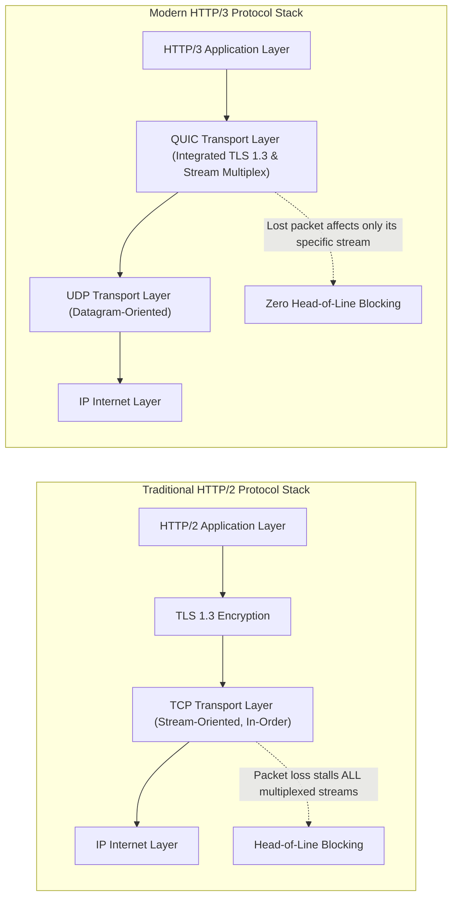

#### 7.2 TLS 1.3 Protocol Mechanics (RFC 8446)

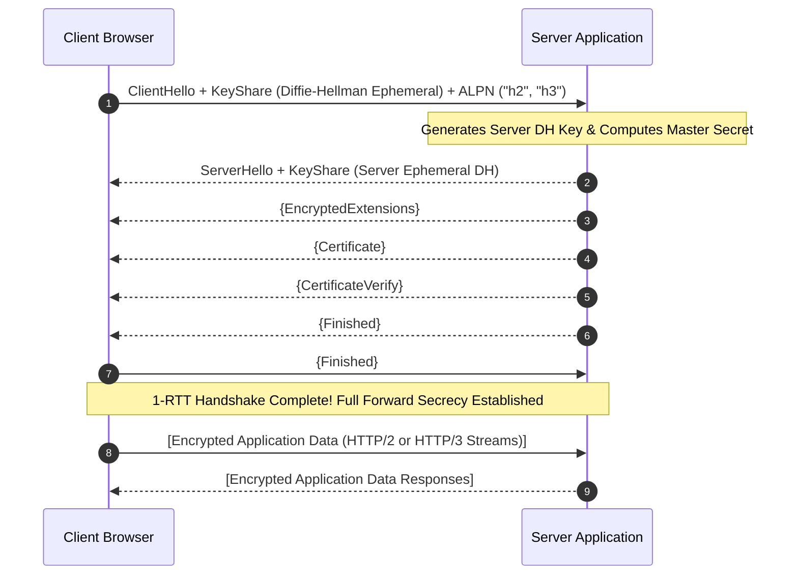

---

### 8. Deep Linux Kernel Engineering & Hardware-Aware Performance

#### 8.1 NUMA Architecture & Cache-Aware Memory Allocation

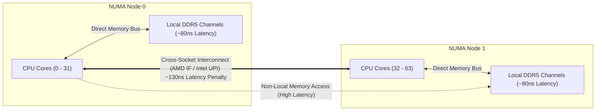

#### 8.2 Hardware Interrupts & Packet Steering (RSS, RPS, RFS, XPS)

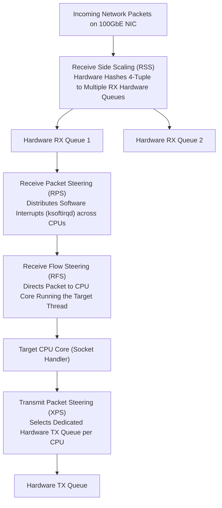

#### 8.3 Bypass Architectures: eBPF, XDP, DPDK & AF_XDP

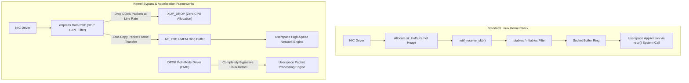

---

### 9. Enterprise Hardware Architecture & Component Engineering

#### 9.1 High-Density Accelerator Platforms & Direct Liquid Cooling (DLC)

Modern dense AI/GPU racks (such as NVIDIA HGX and NVL72 configurations) exceed **40 kW to 120 kW per rack**, surpassing the cooling capacity of traditional air chillers:

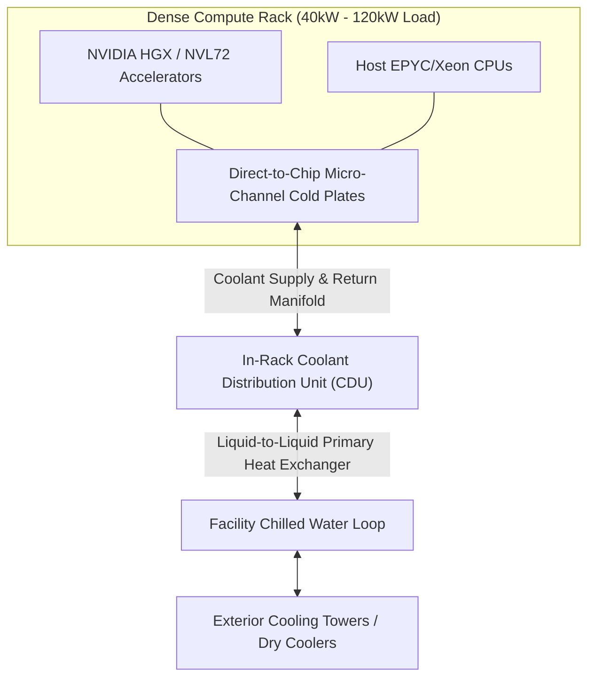

---

### 10. Data Center Facilities, Power, Cooling & Physical Security

#### 10.1 Electrical Distribution: Transformers, ATS, UPS & Generators

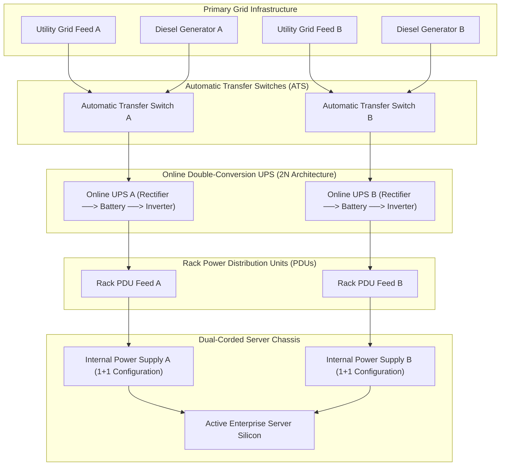

---

### 11. Public Internet Infrastructure, Autonomous Systems, BGP & Edge Routing

#### 11.1 Border Gateway Protocol (BGP-4) Engineering & Multihoming

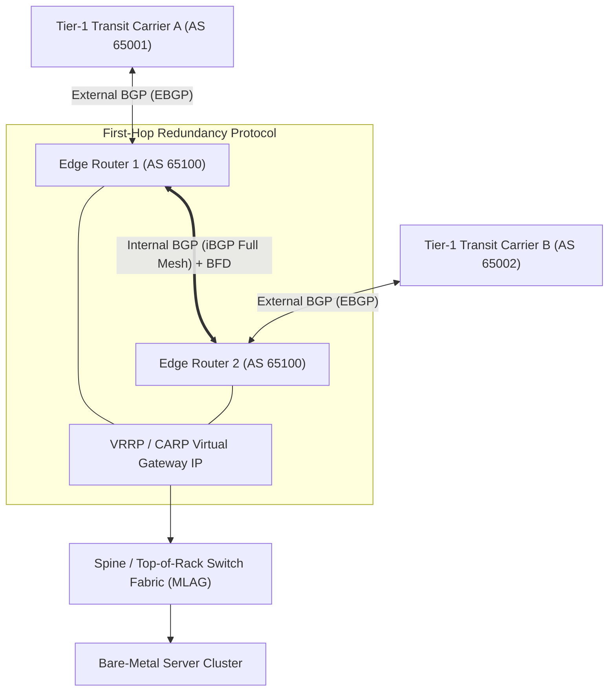

---

### 12. Bare-Metal Automation, Machine Provisioning & Kubernetes

#### 12.1 Automated Bootstrapping: DHCP, TFTP, PXE/iPXE & Ignition

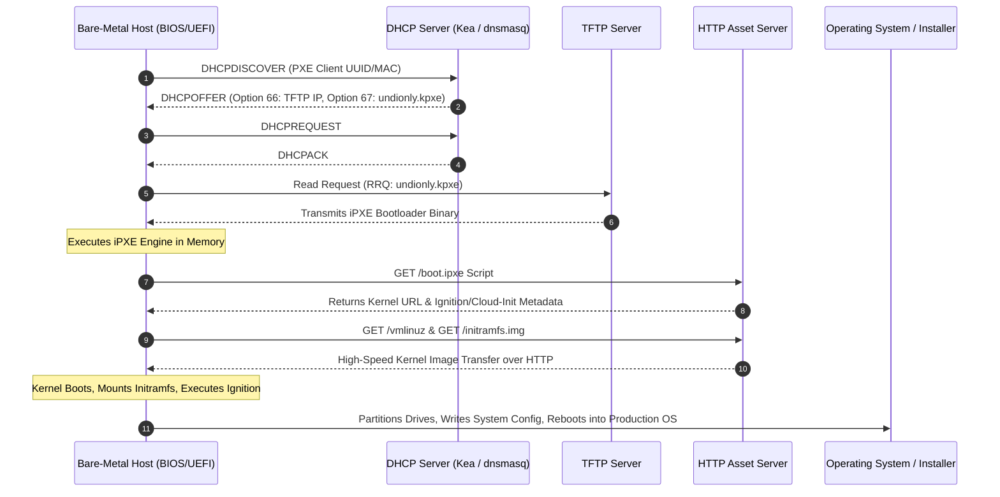

#### 12.2 Operating Bare-Metal Kubernetes without Cloud Hyperscalers

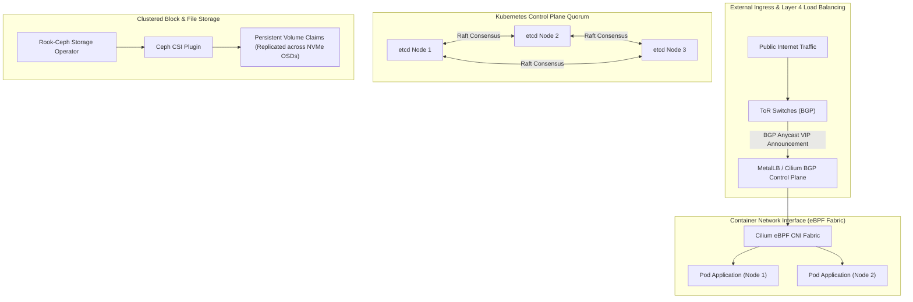

---

### 13. Distributed Storage, Consensus Algorithms & Database Durability

#### 13.1 Distributed Consensus: Raft Protocol Flow

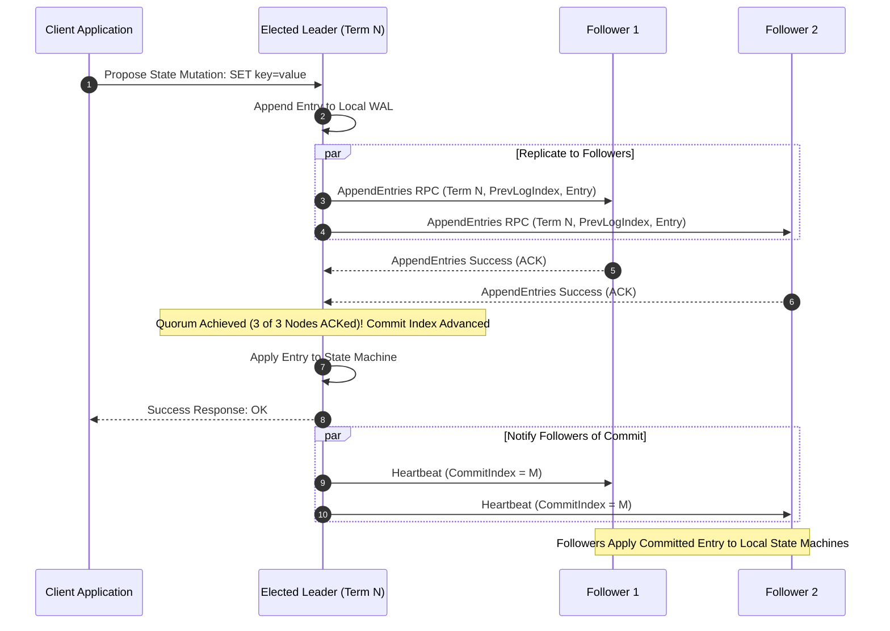

#### 13.2 Database Engine Durability: PostgreSQL WAL & PITR

```mermaid
flowchart TD
    SQL["SQL COMMIT Statement Issued"] --> WAL_BUF["Append Record to In-Memory WAL Buffer"]
    WAL_BUF --> FSYNC["fsync() WAL Record to Persistent Disk (SLOG / NVMe)"]
    
    subgraph Durability_Gate["Transaction Durability Boundary"]
        FSYNC --> SYNC_CONFIRM["Disk Controller Flush Confirmed"]
    end

    SYNC_CONFIRM --> SUCCESS["Return 'Transaction Committed' to Client"]
    
    subgraph Deferred_Process["Deferred Background Engine"]
        DIRTY_PAGES["Shared Memory Dirty Buffer Pages"] --> BG_WRITER["Background Checkpointer Process"]
        BG_WRITER --> DATA_FILES["Flushed to Data Table Files (base/oid)"]
    end
```

---

### 14. High Availability, Cluster Quorum & Disaster Recovery

#### 14.1 High Availability Clustered Hypervisors: Proxmox VE & QDevice

```mermaid
flowchart TD
    subgraph Cluster["2-Node High Availability Virtualization Cluster"]
        NODE1["Proxmox Host 1 (1 Vote)"]
        NODE2["Proxmox Host 2 (1 Vote)"]
        NODE1 <===>|"Corosync Cluster Network"| NODE2
    end

    subgraph External["Independent Arbitration Failure Domain"]
        QDEVICE["External QDevice (corosync-qnetd)<br/>Deployed on Independent Subnet (1 Vote)"]
    end

    NODE1 <--->|"QNet Heartbeat"| QDEVICE
    NODE2 <--->|"QNet Heartbeat"| QDEVICE

    NODE1 -.->|"Total Votes = 2 of 3 (Majority Formed)"| QUORUM["Cluster Maintains Quorum during 1-Node Failure!"]
```

#### 14.2 Disaster Recovery Metrics: RPO & RTO

```mermaid
flowchart LR
    BACKUP["Last Valid Backup Snapshot<br/>(02:00:00)"]
    DISASTER["Catastrophic System Outage<br/>(02:15:00)"]
    RESTORED["Services Fully Operational<br/>(02:45:00)"]

    BACKUP -->|"RPO Window (15 Minutes Data Loss)"| DISASTER
    DISASTER -->|"RTO Window (30 Minutes Downtime)"| RESTORED
```

---

### 15. Zero-Trust Security, Firmware Protection & Compliance

- **NIST SP 800-193 Platform Firmware Resiliency:** Protection, Detection, Recovery across SPI flash and microcode.
- **TPM 2.0 Measured Boot:** PCR hash extensions verifying UEFI, bootloader, kernel, and initramfs integrity.
- **Isolated Management Plane:** Out-of-band BMC networks separated on physically disjoint switches with zero internet access.

---

### 16. Modern Observability, Distributed Tracing & Site Reliability Engineering

```mermaid
flowchart TD
    subgraph Workloads["Host & Container Workloads"]
        APP["Application Containers"]
        HOST["Bare-Metal Host OS"]
    end

    subgraph Collection["Telemetry Collection Plane"]
        OTEL["OpenTelemetry Collector Agent"]
        ALLOY["Grafana Alloy (Unified Daemon)"]
        APP -->|"Traces (OTLP/gRPC)"| OTEL
        APP -->|"Application Logs"| ALLOY
        HOST -->|"Node Exporter Kernel Metrics"| ALLOY
    end

    subgraph Storage_Backends["Time-Series & Telemetry Storage"]
        ALLOY -->|"Metrics"| PROM["Prometheus / Mimir TSDB"]
        ALLOY -->|"Structured Logs"| LOKI["Grafana Loki"]
        OTEL -->|"Spans & Traces"| TEMPO["Grafana Tempo"]
    end

    subgraph Visualization["Unified SRE Dashboard"]
        PROM --> GRAFANA["Grafana Visualization & Alertmanager"]
        LOKI --> GRAFANA
        TEMPO --> GRAFANA
    end
```

---

### 17. Infrastructure Financial Engineering: Total Cost of Ownership (TCO) & Cloud Arbitrage

#### Realistic Financial Modeling
While self-hosted infrastructure eliminates hyperscaler markups, claiming universal "80–90% savings" is an oversimplification. Realistic financial engineering accounts for:
- **Unutilized Headroom:** Enterprise clusters require 30–50% spare capacity to survive node failure domains without degraded performance.
- **Colocation Charges:** Monthly Recurring Charges (MRC) for rack space, committed power (kVA), and cross-connect fees ($300–$1000/mo per fiber cross-connect).
- **Engineering Personnel:** 24/7/365 on-call systems engineers, site reliability engineers, and network architects.

$$\text{Annual Power Cost} = \text{Average Server Draw (kW)} \times 24 \times 365 \times \text{Facility PUE} \times \text{Electricity Tariff (\$/kWh)}$$

---

### 18. Testing, Verification, Fault Injection & Production Acceptance

- **Performance Validation:** `fio` random 4K IOPS, `stress-ng` CPU/memory thrashing, `iperf3` line-rate link saturation.
- **Chaos Injection:** Unannounced PDU power loss, active NVMe disk pulls, synthetic link degradation via `tc-netem`.

---

### 19. End-to-End Reference Implementations & Deployment Roadmaps

```mermaid
flowchart TD
    S1["Stage 1: Single-Node Learning Lab<br/>• Intel N100 / AMD Ryzen Mini-PC<br/>• Proxmox VE + Mirrored ZFS SSDs<br/>• Caddy Reverse Proxy (Auto TLS)<br/>• Administrative Access via Tailscale Mesh"]
    
    S2["Stage 2: 3-Node Enterprise High-Availability Cluster<br/>• 3x 1U/2U Rackmount Servers (AMD EPYC / Intel Xeon with ECC)<br/>• Dual 10GbE SFP+ Private Corosync Cluster Network<br/>• Ceph Replicated Distributed Block Storage<br/>• MetalLB / Cilium BGP Service Ingress"]
    
    S3["Stage 3: Multi-Rack Colocated Infrastructure with BGP Multihoming<br/>• Multiple 42U Cold Aisle Contained Racks<br/>• 2N Dual Power Paths (ATS, Online Double-Conversion UPS, Diesel Gen)<br/>• Public ASN with BGP Multihoming across Dual Tier-1 Carriers<br/>• 25GbE/100GbE Leaf-Spine Fabric with MLAG<br/>• Isolated Out-of-Band IPMI/BMC Management Network"]

    S1 ==> S2 ==> S3
```

---

### 20. Primary Bibliography & Foundational Standards

- **RFC 9112 / RFC 9114 / RFC 9000 / RFC 8446 / RFC 6455**
- **Linux Kernel Documentation:** *Kernel Admin Guide, epoll(7), io_uring(7)*
- **OpenZFS Official Documentation & Proxmox VE Admin Guide**
- **NIST SP 800-193 & Uptime Institute Tier Standard**

---

## Part II: Advanced Self-Hosted Infrastructure Platform Engineering

---

### 21. Server Fleet Management, Asset Inventory & Redfish Automation

Managing bare-metal infrastructure across tens or hundreds of machines via ad-hoc SSH scripts guarantees configuration drift, operational blind spots, and catastrophic maintenance mistakes. Production infrastructure demands a declarative source of truth and standardized out-of-band automation.

```mermaid
flowchart TD
    subgraph NetBox_SSOT["NetBox: Central Source of Truth (DCIM / IPAM)"]
        DEV["Physical Asset (Serial, Asset Tag, Rack Position, U-Height)"]
        PWR["Power Ports, PDUs, A/B Feed Topology"]
        NET["Interfaces, MACs, IP Prefixes, VLANs, VRFs"]
        ROLE["Platform Role, OS Profile, Service Dependencies"]
    end

    subgraph Automation_Engine["Fleet Automation Engine (Python / Go / Ansible)"]
        ORCH["Fleet Orchestrator"]
    end

    NetBox_SSOT <-->|"REST API / Webhooks (State Reconciliation)"| ORCH

    subgraph OOB_Network["Isolated Out-of-Band Management Network"]
        REDFISH["DMTF Redfish 2026.1 API (HTTPS / JSON / OData)"]
        BMC["ASPEED AST2600 BMC Controller"]
    end

    ORCH -->|"Secure Redfish Calls"| REDFISH
    REDFISH --> BMC
    BMC -->|"Hardware Execution"| SERVER["Host Bare-Metal Silicon (Power, BIOS, Telemetry, Media)"]
```

#### 21.1 Infrastructure Inventory and DCIM (Data Center Infrastructure Management)
A deployment cannot be considered automated until every physical and logical attribute is recorded in an authoritative IPAM/DCIM database (such as NetBox):
- **Physical Rack Sizing & Power Paths:** Documenting rack unit coordinates (e.g., Rack A04, U18–U20), breaker panels, PDU outlet assignments (Feed A Outlet 12, Feed B Outlet 12), and structured fiber patch panel routes.
- **Hardware Component Tracking:** Exact vendor part numbers, serial numbers, warranty expiration dates, and DIMM slot population maps.
- **Network Interfaces & IPAM:** MAC addresses, bonded link topologies (LACP trunking), untagged management VLANs, tagged tenant VLANs, and IPv4/IPv6 allocations.

#### 21.2 Automated Hardware Management via DMTF Redfish 2026.1 APIs
DMTF Redfish provides a RESTful, JSON-formatted, schema-validated management interface over HTTPS, replacing obsolete proprietary IPMI tools.

##### Common Redfish Endpoints
- `/redfish/v1/Systems/{SystemId}`: System overview, CPU/memory summary, power state.
- `/redfish/v1/Systems/{SystemId}/Actions/ComputerSystem.Reset`: Programmatic power cycling (`On`, `ForceOff`, `GracefulShutdown`, `ForceRestart`).
- `/redfish/v1/Managers/{ManagerId}/VirtualMedia`: Attaches remote ISO installation media over HTTPS.
- `/redfish/v1/UpdateService`: Staged, cryptographic firmware updates across UEFI, BMC, and NIC flash.

##### Concrete Redfish Automation Example (Python)
```python
import requests
import json
import urllib3
urllib3.disable_warnings(urllib3.exceptions.InsecureRequestWarning)

class RedfishManager:
    def __init__(self, bmc_ip: str, auth: tuple):
        self.base_url = f"https://{bmc_ip}/redfish/v1"
        self.auth = auth
        self.session = requests.Session()
        self.session.auth = auth
        self.session.verify = False # In production, verify against internal OOB CA

    def get_system_health(self) -> dict:
        url = f"{self.base_url}/Systems/Self"
        resp = self.session.get(url, timeout=10)
        resp.raise_for_status()
        data = resp.json()
        return {
            "PowerState": data.get("PowerState"),
            "HealthStatus": data.get("Status", {}).get("Health"),
            "Model": data.get("Model"),
            "SerialNumber": data.get("SerialNumber"),
            "ProcessorCores": data.get("ProcessorSummary", {}).get("Count"),
            "TotalMemoryGiB": data.get("MemorySummary", {}).get("TotalSystemMemoryGiB")
        }

    def set_one_time_boot(self, target="UefiHttp"):
        url = f"{self.base_url}/Systems/Self"
        payload = {
            "Boot": {
                "BootSourceOverrideTarget": target,
                "BootSourceOverrideEnabled": "Once"
            }
        }
        headers = {"Content-Type": "application/json"}
        resp = self.session.patch(url, data=json.dumps(payload), headers=headers, timeout=10)
        resp.raise_for_status()
        return resp.status_code

if __name__ == "__main__":
    rf = RedfishManager("192.168.100.42", ("admin", "SuperSecureOOBPassword"))
    print("Discovered Node:", rf.get_system_health())
```

---

### 22. Building a Private Cloud from Bare Metal: AWS-Equivalent Services

Owning physical servers yields raw computing power, but transforming them into a resilient developer platform requires replacing cloud primitives with open-source systems.

```mermaid
flowchart TD
    subgraph Management_Plane["1. Management Plane (Isolated Out-of-Band Network)"]
        NETBOX["NetBox DCIM / IPAM"]
        IRONIC["OpenStack Ironic / MAAS (Bare-Metal Engine)"]
        REDFISH_M["Redfish Firmware & Power Controller"]
    end

    subgraph Control_Plane["2. Control Plane (Kubernetes & Orchestration Core)"]
        K8S_CTRL["Kubernetes API Server Quorum"]
        VAULT["HashiCorp Vault (KMS & Secrets)"]
        KEYCLOAK["Keycloak OIDC / SPIRE (IAM & Identity)"]
        ARGO["ArgoCD GitOps Engine"]
    end

    subgraph Data_Plane["3. Data Plane (Workloads, Storage & Routing)"]
        TALOS["Talos Linux Compute Nodes"]
        CEPH["Ceph Distributed Storage (RBD Block / RGW S3)"]
        PATRONI["Patroni HA PostgreSQL Clustered DBs"]
        ENVOY["Envoy / HAProxy Layer 7 Edge Ingress"]
    end

    subgraph Recovery_Plane["4. Recovery Plane (Air-Gapped Disaster Survival)"]
        RESTIC["Restic / pgBackRest Immutable Repository"]
        COLD_KEYS["Hardware Root Keys & Recovery Runbooks"]
        EMERG_VPN["Independent Cellular OOB Terminal Console"]
    end

    Management_Plane --> Control_Plane
    Control_Plane --> Data_Plane
    Data_Plane -.->|"Continuous Streaming Backups"| Recovery_Plane
```

#### 22.1 Cloud Service Replacement Matrix

| Public Cloud Service | Production Self-Hosted Alternative | Implementation Architecture |
| :--- | :--- | :--- |
| **AWS EC2** | KVM / Proxmox VE / OpenStack Nova | Linux KVM kernel virtualization, virtio-net, virtio-blk |
| **AWS EKS** | Self-Managed Kubernetes on Talos Linux | Immutable container-optimized OS, zero SSH, declarative API |
| **AWS S3** | Ceph RADOS Gateway (RGW) | Multi-part S3-compliant RESTful object store over Ceph OSDs |
| **AWS EBS** | Ceph RBD (RADOS Block Device) | Kernel-mapped distributed block devices with snapshots |
| **AWS RDS** | Patroni + PostgreSQL + pgBackRest | High-availability PostgreSQL, Raft/etcd consensus, automated failover |
| **AWS ELB / ALB** | Cilium BGP + Envoy Gateway / HAProxy | Anycast BGP VIP ingress with HTTP/3, TLS 1.3, rate-limiting |
| **AWS IAM** | Keycloak + SPIFFE/SPIRE | OIDC/OAuth2 authentication and cryptographic mTLS SVIDs |
| **AWS KMS** | HashiCorp Vault (Transit Engine) + PKCS#11 | Envelope encryption with hardware security module backends |
| **AWS CloudWatch** | Prometheus + Loki + Tempo + Grafana | Unified OpenTelemetry metric, log, and trace observability |

---

### 23. Advanced Data Center Networking: IPv6 & EVPN-VXLAN Fabrics

#### 23.1 IPv6 First-Class Architecture
Modern data centers cannot rely on IPv4 NAT. Dual-stack or IPv6-only overlays eliminate private address exhaustion:
- **Global Unicast Address (GUA):** Subnet assignments per rack using `/64` boundaries.
- **Neighbor Discovery Protocol (NDP):** Router Advertisements (RA) and Neighbor Solicitation (NS). **Security imperative:** Enable RA Guard and DHCPv6 Guard on top-of-rack switch ports to prevent rogue gateway spoofing.

#### 23.2 BGP EVPN-VXLAN Data Center Overlays
Traditional Layer 2 spanning tree (STP) disables redundant links to prevent loops, wasting 50% of switch fabric bandwidth. Modern data centers deploy **EVPN-VXLAN**:
- **Underlay Network:** Pure Layer 3 IP routing across a leaf-spine architecture using Equal-Cost Multi-Pathing (ECMP) over BGP.
- **Overlay Network:** Virtual Extensible LAN (VXLAN) encapsulates Layer 2 Ethernet frames into UDP packets (port 4789), carrying a 24-bit VXLAN Network Identifier (VNI) enabling 16 million isolated virtual networks.
- **Control Plane:** Multi-Protocol BGP (MP-BGP) EVPN distributes MAC and IP bindings dynamically, eliminating broadcast flood-and-learn.

```mermaid
flowchart TD
    subgraph Spines["Spine Switch Tier (Pure L3 BGP Underlay)"]
        SPINE1["Spine Switch 1 (IP: 10.0.0.1)"]
        SPINE2["Spine Switch 2 (IP: 10.0.0.2)"]
    end

    subgraph Leafs["Leaf Switch Tier (VTEP - VXLAN Tunnel Endpoints)"]
        LEAF1["Leaf Switch 1 (VTEP 1)"]
        LEAF2["Leaf Switch 2 (VTEP 2)"]
    end

    SPINE1 <===>|"BGP ECMP (Unencapsulated Underlay)"| LEAF1
    SPINE1 <===>|"BGP ECMP"| LEAF2
    SPINE2 <===>|"BGP ECMP"| LEAF1
    SPINE2 <===>|"BGP ECMP"| LEAF2

    LEAF1 <.-.->|"VXLAN Geneve/UDP Tunnel (Overlay VNI 1001)"| LEAF2

    subgraph Rack1["Compute Rack 1"]
        VM1["Tenant VM A (VLAN 10 -> VNI 1001)"] --> LEAF1
    end

    subgraph Rack2["Compute Rack 2"]
        VM2["Tenant VM B (VLAN 10 -> VNI 1001)"] --> LEAF2
    end
```

##### MTU Budgeting Warning
VXLAN adds a 50-byte encapsulation header (14-byte Ethernet + 20-byte IP + 8-byte UDP + 8-byte VXLAN). If host interfaces transmit standard 1500-byte MTU packets, encapsulation results in 1550-byte packets. If the physical switch underlay does not support jumbo frames, packets will be fragmented or dropped. **Physical network interfaces and switches MUST be configured for an MTU of at least 9000 bytes (Jumbo Frames).**

---

### 24. Hardware Lifecycle, Firmware Upgrades & Automated Server Recovery

Production infrastructure demands a systematic hardware lifecycle to prevent degraded silicon from silently corrupting application state.

```mermaid
stateDiagram-v2
    [*] --> Procurement
    Procurement --> Receiving: Physical Verification & Asset Tagging
    Receiving --> Validation: NetBox Inventory Registered
    Validation --> BurnIn: Automated Stress & Parity Testing
    
    state BurnIn {
        [*] --> CPUStress: 24h mprime / stress-ng
        CPUStress --> MemStress: 24h memtester (Zero Parity Errors)
        MemStress --> DiskStress: 24h fio (Max IOPS & Thermals)
    }

    BurnIn --> Provisioning: Passed Burn-In Gates
    BurnIn --> RMA_Replacement: Failed Burn-In (Return to Vendor)
    Provisioning --> Production: Talos / K8s Deployment
    
    state Production {
        [*] --> Monitoring
        Monitoring --> Maintenance: Health Metric Alert (ECC / SMART / DWPD)
        Maintenance --> Monitoring: Component Hot-Swapped
    }

    Production --> Decommissioning: End-of-Life / Lease Expiration
    Decommissioning --> SecureWipe: NIST SP 800-88 Cryptographic Sanitization
    SecureWipe --> [*]
```

#### Drive Endurance (DWPD) & Health Tracking
- **SMART / NVMe Health Monitoring:** Track `Percentage Used` and `Available Spare` attributes. When `Percentage Used` reaches 80% or `Available Spare` drops below 10%, schedule proactive drive replacement before catastrophic failure.
- **Sparing Ratios:** Maintain an on-site inventory of tested hot-spares: 10% spare NVMe drives, 5% spare RAM modules, 5% spare hot-swap power supplies.

---

### 25. Cryptographic Infrastructure, HSMs, Encryption & Machine Identity

#### 25.1 Envelope Encryption Architecture
Never store raw data encryption keys (DEKs) on disk. Implement envelope encryption:
1. Data is encrypted locally using an ephemeral **Data Encryption Key (DEK)** via `AES-256-GCM`.
2. The DEK is encrypted using a **Key Encryption Key (KEK)** residing securely inside HashiCorp Vault or a Hardware Security Module (HSM).
3. The encrypted DEK is stored alongside the ciphertext. Decryption requires Vault/HSM authorization to unwrap the DEK into memory.

#### 25.2 Workload Identity via SPIFFE/SPIRE
Static database passwords and API tokens checked into configuration files represent an extreme security vulnerability. **SPIFFE (Secure Production Identity Framework for Everyone)** provides cryptographically verifiable machine identities:

```mermaid
sequenceDiagram
    autonumber
    participant Workload as Microservice / Database Client
    participant Agent as SPIRE Node Agent
    participant Server as SPIRE Server (CA)

    Workload->>Agent: Request SVID via Workload API (Local Unix Domain Socket)
    Note over Agent: Performs Workload Attestation (inspects PID, UID, cgroup, container hash)
    Agent->>Server: Node Attestation & CSR Submission
    Server-->>Agent: Issues Short-Lived X.509 SVID (Valid for 1 Hour)
    Agent-->>Workload: Delivers SVID Certificate & Private Key
    Workload->>Workload: Initiates Mutual TLS (mTLS) with Target Service using SVID
```

#### 25.3 NIST Post-Quantum Cryptography (PQC) Standards
In August 2024, NIST finalized the principal post-quantum cryptographic standards:
- **FIPS 203:** **ML-KEM** (Module-Lattice-Based Key-Encapsulation Mechanism, derived from Kyber) for general public-key encryption and key exchange.
- **FIPS 204:** **ML-DSA** (Module-Lattice-Based Digital Signature Algorithm, derived from Dilithium) for digital signatures and certificate authorities.
- **FIPS 205:** **SLH-DSA** (Stateless Hash-Based Digital Signature Algorithm, derived from SPHINCS+) as a secondary signature mechanism.
Production servers preparing for quantum-resistant lifecycles must adopt hybrid key exchange (`X25519MLKEM768`) in TLS 1.3 terminations.

---

### 26. Multi-Data-Center Architecture & Geographic Disaster Recovery

#### 26.1 The Physics of Cross-Site Latency
Light travels through single-mode fiber optic cable at approximately $200\text{ km/ms}$ (two-thirds the speed of light in vacuum). A 1,000 km round-trip distance incurs an unavoidable baseline physical latency of:
$$t_{\text{RTT}} \ge \frac{2 \times 1000\text{ km}}{200\text{ km/ms}} = 10\text{ ms}$$
Attempting synchronous cross-site database transactions over distances greater than 50 km degrades database throughput significantly, as every single `fsync` and commit must wait for remote physical optical round-trips.

```mermaid
flowchart TD
    subgraph DC1["Primary Data Center (Frankfurt - Availability Zone 1)"]
        LEADER["Primary Database Leader (Active Writer)"]
        APP1["Application Pods"]
        APP1 --> LEADER
        WAL1["Local WAL Commits (Sync fsync < 0.5ms)"]
        LEADER --- WAL1
    end

    subgraph DC2["Secondary Data Center (Amsterdam - Availability Zone 2)"]
        STANDBY["Streaming Physical Standby (Async / Semi-Sync Replica)"]
        APP2["Read-Only Replica Pods"]
        APP2 --> STANDBY
    end

    LEADER -->|"Asynchronous Streaming WAL (Physical RTT ~6ms)"| STANDBY

    subgraph DC3["Arbitration Site (Paris - Availability Zone 3)"]
        Q_ARB["Raft Consensus Arbitrator / Witness Node"]
    end

    LEADER <===>|"Heartbeat & Fencing"| Q_ARB
    STANDBY <===>|"Heartbeat & Fencing"| Q_ARB
```

##### Split-Brain Defense Rule
Never deploy a 2-site cluster with 1 vote per site. If the WAN fiber link is severed, both sites believe the other is dead and attempt to promote local replicas to primary status, corrupting transactional state. A 3rd independent arbitration site (witness node) is strictly required to establish true quorum.

---

### 27. Advanced Database Engineering, Transactional Consistency & Data Integrity

#### 27.1 Database Engine Durability & Flush Semantics
- **Replication Modes in PostgreSQL:**
  * `synchronous_commit = off`: Transactions commit in memory before WAL disk flush (high throughput, risk of losing last few milliseconds of data on power cut).
  * `synchronous_commit = local`: WAL record must be flushed to local disk (`fsync`) before returning success.
  * `synchronous_commit = on`: Local WAL flushed + acknowledged by the synchronous standby replica.
  * `synchronous_commit = remote_apply`: Local WAL flushed + WAL record physically applied and visible in the standby's memory state before returning success (eliminates stale read replicas).

#### 27.2 Application-Level Transaction Correctness

```mermaid
sequenceDiagram
    autonumber
    participant Client as Client Application
    participant API as Payment API Gateway
    participant DB as Clustered PostgreSQL
    participant Worker as Outbox Relaying Process
    participant Bus as Message Broker (Kafka)

    Client->>API: POST /transfers (Header: Idempotency-Key: UUIDv4)
    API->>DB: BEGIN TRANSACTION;
    Note over DB: 1. Check if Idempotency-Key exists in idempotency_records
    Note over DB: 2. Insert account_balances mutation
    Note over DB: 3. Insert event into transactional outbox table
    API->>DB: COMMIT;

    DB-->>API: Transaction Durably Committed
    API-->>Client: 200 OK (Transfer Processed)

    Worker->>DB: SELECT * FROM outbox WHERE processed = false FOR UPDATE SKIP LOCKED;
    Worker->>Bus: Publish Event to Kafka Topic
    Bus-->>Worker: Kafka ACK (Broker Written)
    Worker->>DB: UPDATE outbox SET processed = true WHERE id = event_id;
```

Distributed applications must never assume "exactly once" network delivery. The **Transactional Outbox Pattern** guarantees that state mutations and outbound domain events are committed atomically within the same database transaction, eliminating message drops and duplicate transactions across network boundaries.

---

### 28. Capacity Forecasting, Workload Placement & Resource Scheduling

#### 28.1 Kubernetes Quality of Service (QoS) Classes
1. **Guaranteed:** `limits` and `requests` are strictly identical for both CPU and memory. The Linux OOM killer will terminate these pods last. Essential for databases, etcd, and core API engines.
2. **Burstable:** `requests` are lower than `limits`. Allowed to burst during spikes, but subject to throttling and eviction under system memory pressure.
3. **BestEffort:** No requests or limits specified. Terminated immediately upon memory contention. Permissible only for transient batch processing jobs.

#### 28.2 Overload Protection Strategies
- **Token Bucket Admission Control:** Sheds excess requests at the edge before they consume thread pool capacity.
- **Priority-Based Load Shedding:** Under system degradation (monitored via cgroup v2 PSI metrics), immediately drop non-critical background jobs (e.g., analytics, reporting, notifications) to preserve compute resources for primary financial transaction pipelines.

---

### 29. Immutable Infrastructure, CI/CD & Secure Supply Chains

Manual server configuration over SSH is an operational anti-pattern. Infrastructure must be built as an immutable artifact from source code.

```mermaid
flowchart TD
    DEV["Engineer Pushes Commit"] --> GIT["Version-Controlled Git Repository"]
    
    subgraph CI_Pipeline["Isolated Ephemeral CI Runner"]
        LINT["OpenTofu / Ansible Lint & Static Security Audit"]
        BUILD["Packer Image Build (Minimal Linux Kernel + Engine)"]
        SBOM["Generate Software Bill of Materials (Syft / CycloneDX)"]
        COSIGN["Cryptographically Sign Image & Provenance (Cosign / SLSA v1.2)"]
    end

    GIT --> LINT --> BUILD --> SBOM --> COSIGN

    subgraph CD_Reconciliation["GitOps Declarative Reconciliation"]
        REGISTRY["Secure Image Registry"]
        ARGO["ArgoCD / GitOps Controller"]
        COSIGN --> REGISTRY
        REGISTRY --> ARGO
        ARGO -->|"Canary Progressive Rollout"| PROD["Bare-Metal Compute Nodes"]
    end
```

---

### 30. Advanced Server Benchmarking, Profiling & Performance Economics

#### 30.1 Coordinated Omission Bias in Benchmarking
Traditional closed-loop benchmarking tools (e.g., standard `ab` or misconfigured generators) pause request generation while waiting for the previous response to complete. If the server stalls for 5 seconds due to a full garbage collection pause, the tool pauses as well, hiding the fact that hundreds of incoming requests would have stalled during that interval.
- **Open-Loop Generators:** Tools like **k6**, **wrk2**, or **Vegeta** issue requests according to a strict timeline independent of server completion times, accurately recording latency spikes.

#### 30.2 Cost-Adjusted Efficiency Metrics
Evaluate servers using normalized operational efficiency:
$$\text{Cost Efficiency} = \frac{\text{Transactions Per Second (TPS)}}{\text{Average Power Consumption (Watts)}}$$
$$\text{Sustained Capacity TCO} = \frac{\text{5-Year Total Hardware, Power \& Colocation Cost}}{\text{Million Sustained Monthly Requests}}$$

---

### 31. AI & GPU Server Infrastructure, Distributed Training & Inference

Dense AI accelerator platforms require dedicated interconnect topologies and storage fabrics.

```mermaid
flowchart TD
    subgraph GPU_Topology["Dense 8-GPU Accelerator Node (e.g., NVIDIA HGX)"]
        GPU0["GPU 0"] <===>|"NVLink Mesh (900 GB/s Bi-directional)"| GPU1["GPU 1"]
        GPU1 <===>|"NVLink"| GPU2["GPU 2"]
        GPU2 <===>|"NVLink"| GPU3["GPU 3"]
        GPU0 --- PCIE_SW1["PCIe Gen 5 Switch"]
        GPU1 --- PCIE_SW1
    end

    subgraph RDMA_Fabric["High-Speed Cluster Fabric (400Gbps / 800Gbps)"]
        NIC1["ConnectX-7 CX7 NIC (RoCEv2 / InfiniBand)"]
        PCIE_SW1 -->|"GPUDirect RDMA (Bypasses Host CPU & RAM entirely)"| NIC1
        NIC1 <===> LEAF_SPINE["Lossless Network Switch Fabric (PFC & ECN Enabled)"]
    end
```

- **GPUDirect RDMA:** Allows GPUs to transfer data across the network interface card directly to remote GPUs without copying data into host CPU memory or traversing the kernel networking stack.
- **Lossless Ethernet (RoCEv2):** Requires configuring **Priority Flow Control (PFC - IEEE 802.1Qbb)** to eliminate dropped packets, combined with **Explicit Congestion Notification (ECN)** to prevent buffer bloat.

---

### 32. Time Synchronization, Precision Clocks & Distributed Event Ordering

#### 32.1 Clock Accuracy Architectures
- **Chrony NTP:** Standard network time protocol achieving millisecond accuracy ($\pm 1\text{ ms} - 10\text{ ms}$) across public internet transit, and sub-millisecond accuracy over local private networks.
- **Precision Time Protocol (PTP - IEEE 1588v2):** Uses dedicated hardware timestamping embedded directly inside network interface physical layers (PHY), delivering **sub-microsecond accuracy ($\pm 100\text{ ns}$)** across supported switches.

#### 32.2 Monotonic vs. Wall-Clock Time
- **`CLOCK_REALTIME` (Wall-Clock Time):** Reflects physical human time. It is subject to NTP stepping, slewing, and leap second adjustments. **Never compute timeouts, latency durations, or transaction intervals using wall-clock time.**
- **`CLOCK_MONOTONIC` / `CLOCK_MONOTONIC_RAW`:** A strictly non-decreasing counter measuring time elapsed since an arbitrary system start point. It cannot jump backwards, guaranteeing accurate duration measurements.
- **Distributed Causal Ordering:** Real-world physical clocks drift. Distributed databases must never rely on physical timestamps alone to establish linearizability. Instead, they use **Lamport Timestamps**, **Vector Clocks**, or **Hybrid Logical Clocks (HLC)** combining physical timestamps with logical sequence counters.

---

### 33. Cybersecurity Operations, Incident Response & Digital Forensics

#### 33.1 Runtime Threat Detection with eBPF
Traditional host intrusion detection systems (HIDS) rely on periodic file scans or auditd logging, which attackers can disable. Modern runtime security uses **eBPF (Extended Berkeley Packet Filter)** engines such as **Falco**:
- Hooks directly into kernel tracepoints (`sys_enter_execve`, `sys_enter_connect`, `security_file_open`).
- Detects unauthorized shells executed inside containers, privilege escalations, unexpected kernel module insertions, and outbound connections to known command-and-control IPs at line rate.

#### 33.2 Digital Forensics & Volatile Memory Preservation
In the event of an advanced persistent threat (APT) compromise:
1. **Never Power Off the Host:** Shutting down or rebooting destroys volatile memory containing in-flight cryptographic keys, unencrypted network sessions, and rootkit structures.
2. **Volatile Memory Dumping:** Use **LiME (Linux Memory Extractor)** to stream an exact physical RAM image across an isolated network pipe to a hardened evidence storage server before terminating compromised processes.

---

### 34. Infrastructure Governance, Vendor Contracts, Legal Obligations & Compliance

Operating self-hosted infrastructure introduces legal and contractual obligations previously abstracted by managed cloud vendors:

#### 34.1 Vendor Contracts & Colocation SLAs
- **Power Availability Guarantees:** Ensure colocation Service Level Agreements (SLAs) stipulate 100% uptime for 2N redundant power configurations with financial penalty clauses for downtime.
- **Remote-Hands Response SLAs:** Contractually enforce response times for physical hardware interventions (e.g., 30-minute SLA for replacing a failed hot-swap drive or power supply).

#### 34.2 Regulatory Compliance Architecture
- **India DPDP Act (2023):** Mandates reasonable security safeguards for personal data, strict purpose limitations, and timely breach disclosures.
- **CERT-In Cyber Incident Reporting (Directions under Section 70B):** Mandates that system operators **must report specified cybersecurity incidents to CERT-In within 6 hours** of noticing or being brought to notice of such incidents. Requires maintaining server and network logs securely within Indian jurisdiction for a rolling period of **180 days**.
- **PCI DSS v4.0.1 Compliance:** For payment workloads, enforce strict Cardholder Data Environment (CDE) physical and logical network isolation, quarterly ASV vulnerability scans, and multi-factor authentication across all administrative access points.

---

### 35. Cloud-to-Bare-Metal Migration & Cutover Engineering

Migrating production workloads from public cloud hyperscalers to bare-metal infrastructure requires a structured, multi-phase cutover methodology:

```mermaid
flowchart TD
    subgraph P1["Phase 1: Discovery & Parallel Provisioning"]
        DISC["Automated Inventory of Cloud Instances, DBs, S3 Buckets & DNS"]
        PROV["Bare-Metal Cluster Commissioning & Hardening"]
    end

    subgraph P2["Phase 2: Continuous Data Replication"]
        DB_REPL["Continuous Database Streaming (Cloud Leader -> Bare-Metal Standby)"]
        OBJ_REPL["Bidirectional Object Storage Sync (S3 -> Ceph RGW)"]
    end

    subgraph P3["Phase 3: Canary Traffic Shifting"]
        DNS_WEIGHT["Weighted DNS / BGP Route Advertisement"]
        SYNTH["Synthetic Verification of Transactions on Bare Metal"]
        RECON["Continuous Financial & Transactional Data Reconciliation"]
    end

    subgraph P4["Phase 4: Final Cutover & Decommission"]
        CUT["Promote Bare-Metal DB to Primary Leader"]
        FREEZE["Set Cloud Database to Read-Only"]
        DECOM["Verify 30-Day Stability Gate before Cloud Resource Deletion"]
    end

    P1 --> P2 --> P3 --> P4
```

---

### 36. Production Implementation, Acceptance Framework & Verification Drills

#### The Production Acceptance Gate Scorecard
Before traffic is routed to newly commissioned infrastructure, the platform must pass every defined verification gate:

| Verification Gate | Test Procedure | Pass / Fail Criteria |
| :--- | :--- | :--- |
| **1. Compute & Thermal** | 24-hour continuous CPU/GPU load via `stress-ng` & `mprime` | Zero thermal throttling; core temps remain $\le 75^\circ\text{C}$ |
| **2. Memory Integrity** | 24-hour continuous `memtester` run across 95% of physical RAM | Zero single-bit or multi-bit uncorrectable ECC alerts in IPMI |
| **3. Storage IOPS** | `fio` 4K random read/write test at queue depth 64 | Reaches manufacturer rated IOPS within 10%; zero I/O timeout errors |
| **4. Power Path Failover** | Physical disconnect of PDU Feed A while under peak load | Zero reboots; Secondary PSU B assumes 100% load instantly |
| **5. Network Redundancy** | Disconnect primary 25GbE switch uplink during active iperf3 test | Failover to bonded secondary link completes with zero dropped TCP connections |
| **6. Database PITR** | Initiate recovery drill from backup snapshot taken 1 hour prior | Point-in-time state restored within RTO $\le 30\text{ min}$; zero corrupted records |
| **7. Quorum Arbitration** | Terminate primary virtualization node in 2-node cluster | External QDevice arbitrates; surviving node maintains quorum without split-brain |
| **8. Security Isolation** | Execute unauthorized root escalation & egress test from container | AppArmor & non-root user namespace block access; Falco alerts within 1 second |

---

### 37. Master Bibliography & Authoritative Specifications

1. **Protocol & Networking Standards:**
   - **IETF RFC 9112:** *HTTP/1.1 Specification* (Fielding, Nottingham, Reschke).
   - **IETF RFC 9114:** *HTTP/3 Transport Protocol* (Bishop).
   - **IETF RFC 9000:** *QUIC: A UDP-Based Multiplexed and Secure Transport* (Iyengar, Thomson).
   - **IETF RFC 8446:** *The Transport Layer Security (TLS) Protocol Version 1.3* (Rescorla).
   - **IETF RFC 7348:** *Virtual eXtensible Local Area Network (VXLAN)*.
   - **IETF RFC 8365:** *A Network Virtualization Overlay Solution Using Ethernet VPN (EVPN)*.
   - **IETF RFC 6455 & RFC 1035:** *The WebSocket Protocol & Domain Names Implementation*.
2. **Hardware Management & Cloud Platforms:**
   - **DMTF Redfish Standard 2026.1:** *Redfish Scalable Platforms Management API Specification* ([redfish.dmtf.org](https://redfish.dmtf.org/)).
   - **NetBox Documentation:** *Open Source IPAM and DCIM Platform* ([netboxlabs.com](https://netboxlabs.com/)).
   - **OpenStack Ironic:** *Bare Metal Provisioning API & Architecture* ([docs.openstack.org/ironic](https://docs.openstack.org/ironic/)).
   - **OpenZFS Official Documentation:** *ZFS Architecture, SLOG vs. ZIL, ARC/L2ARC* ([openzfs.github.io](https://openzfs.github.io/)).
3. **Security, Cryptography & Government Frameworks:**
   - **NIST FIPS 203, 204, 205 (August 2024 / 2026):** *Post-Quantum Cryptographic Standards (ML-KEM, ML-DSA, SLH-DSA)*.
   - **NIST SP 800-193:** *Platform Firmware Resiliency Guidelines*.
   - **NIST SP 800-88 Rev. 1:** *Guidelines for Media Sanitization*.
   - **Cloud Native Computing Foundation (CNCF):** *SPIFFE/SPIRE Workload Identity Specification* ([spiffe.io](https://spiffe.io/)).
   - **OpenSSF SLSA:** *Supply-chain Levels for Software Artifacts (SLSA) v1.2*.
   - **PCI Security Standards Council:** *Payment Card Industry Data Security Standard (PCI DSS) v4.0.1*.
   - **Ministry of Electronics and Information Technology (MeitY):** *Digital Personal Data Protection Act (DPDP), 2023 & CERT-In Cyber Security Directions*.

---

*Compiled as an authoritative, exhaustive technical engineering report for designing, implementing, securing, and operating production-grade server infrastructure.*
