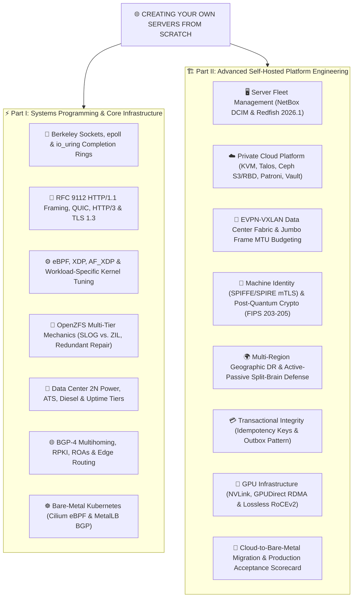
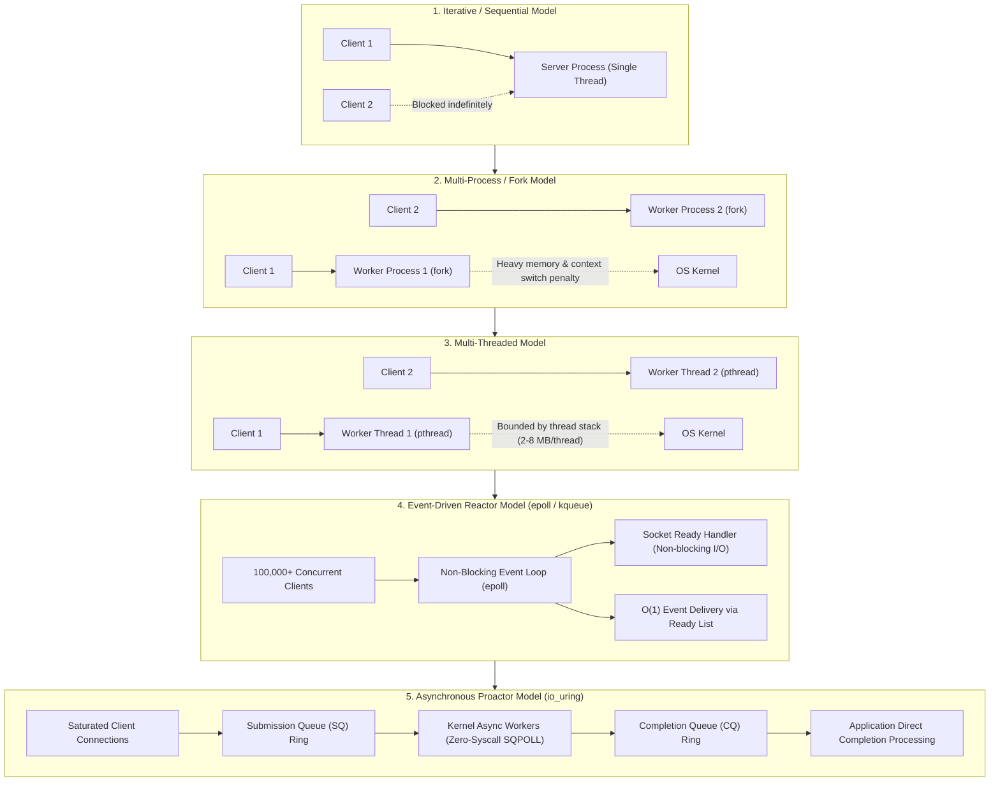

# 🖥️ Creating Your Own Servers From Scratch

  
  
  
  
  
  
  

  
  
  
  
  
  

  
  
  
  
  
  

---

## 📌 Executive Overview

**Creating Your Own Servers from Scratch** is an exhaustive, research-grade engineering blueprint and implementation guide for designing, assembling, routing, hardening, and operating production-grade server infrastructure. It covers two foundational engineering pillars:

1. ⚡ **Low-Level Software Server Engineering:** POSIX Berkeley sockets, $\mathcal{O}(1)$ event demultiplexing (`epoll`, `kqueue`), zero-syscall shared memory rings (`io_uring`), RFC 9112 HTTP/1.1 framing, RFC 9000 QUIC, RFC 9114 HTTP/3, RFC 8446 TLS 1.3, RFC 6455 WebSockets, Redis RESP, and UDP DNS engines.
2. 🏗️ **Enterprise Bare-Metal Infrastructure & Private Cloud Platforms:** Data center 2N power distribution (ATS, double-conversion online UPS, diesel generators), autonomous routing (ASN, BGP-4 multihoming, RPKI, EVPN-VXLAN fabrics), bare-metal Kubernetes without hyperscalers, distributed consensus (Raft/Paxos), database transaction durability (WAL, PITR, idempotency keys, transactional outbox), firmware resilience (NIST SP 800-193, TPM 2.0), SPIFFE/SPIRE workload identities, and cloud-to-bare-metal cutover engineering.

---

## 🧭 Quick Navigation

- 📄 **[Detailed Engineering Report (37 Sections)](CREATING_SERVERS_FROM_SCRATCH_REPORT.md)**: The complete, unabridged master reference manual.

---

## 🏛️ Global Architectural Topology

---

## 🛠️ Complete Tech Stack & Ecosystem Matrix

| Domain | Technologies & Protocols | Badges & Standards |
| :--- | :--- | :--- |
| **Low-Level I/O & Systems** | Berkeley Sockets, POSIX, Linux Kernel, `epoll`, `kqueue`, `io_uring`, POSIX Threads (`pthread`) |    |
| **Application Protocols** | HTTP/1.1 (RFC 9112), HTTP/2 (RFC 9113), HTTP/3 (RFC 9114), QUIC (RFC 9000), WebSockets (RFC 6455), RESP |    |
| **Kernel Acceleration** | eBPF, XDP (eXpress Data Path), AF_XDP (Zero-Copy UMEM), DPDK, HugePages, cgroup v2 PSI |   |
| **Silicon & Hardware** | AMD EPYC 9005 (12-ch DDR5), Intel Xeon 6, CXL 2.0, Enterprise NVMe (PLP), ASPEED AST2600 BMC |   |
| **Storage Subsystems** | OpenZFS (RAIDZ2, SLOG, L2ARC), Ceph (CRUSH, RBD, RGW S3), NVMe-oF (RoCEv2 / TCP) |   |
| **Data Center Facilities** | Uptime Tiers I–IV, 2N Dual Power, Online Double-Conversion UPS, ATS, Diesel Generators, PUE $\le 1.2$ |   |
| **Public & DC Networking** | BGP-4, ASN, RPKI, ROAs, EVPN-VXLAN Overlays, Leaf-Spine ECMP, VRRP, MTU 9000 Jumbo Frames |   |
| **Fleet Automation** | NetBox DCIM/IPAM, DMTF Redfish 2026.1, OpenStack Ironic, PXE/iPXE, Ignition, Ansible, OpenTofu |   |
| **Bare-Metal Kubernetes** | Talos Linux, Self-Managed K8s, Cilium eBPF CNI, MetalLB BGP Anycast VIPs, Rook-Ceph CSI |   |
| **Databases & Durability** | Clustered PostgreSQL, Patroni HA, etcd Quorum, WAL Archiving, PITR, Transactional Outbox |   |
| **Security & Identity** | SPIFFE/SPIRE mTLS, HashiCorp Vault Transit, TPM 2.0 Measured Boot, NIST FIPS 203–205 (ML-KEM) |   |
| **Observability & SRE** | OpenTelemetry Collector, Prometheus TSDB, Grafana Loki, Tempo, Grafana Alloy, eBPF Profiles |   |

---

## 📈 Concurrency Architecture Evolution

---

## 📑 Master Table of Contents

### Part I: Systems Programming, Protocols & Single-Node Infrastructure
- **1. 🔌 Software Architecture: Sockets, Concurrency & Low-Level I/O** (`listen` backlog semantics, memory per connection, `epoll` complexity, `io_uring` SQPOLL)
- **2. 📜 Protocol Engineering from Scratch** (RFC 9112 framing, repeated headers, chunked trailers, Redis RESP, RFC 6455 WebSockets, UDP DNS)
- **3. ⚙️ OS Kernel & TCP/IP Stack Performance Tuning** (Workload profiles: Edge Gateway, Database, Low-Latency Engine)
- **4. 💻 Hardware & Physical Infrastructure Foundations** (Enterprise silicon, AMD EPYC 9005 vs Intel Xeon, ECC memory, OpenZFS SLOG vs write cache, redundant self-healing)
- **5. 🛠️ Production-Grade Reference Implementations**
  - **Blueprint A:** Robust C Non-Blocking TCP Echo Server with `epoll`, output buffering, backpressure, and half-close handling.
  - **Blueprint B:** RFC 9112 Strict Asynchronous HTTP/1.1 Server in Python with repeated header concatenation and chunked trailers.
  - **Blueprint C:** Hardened Production Docker Compose Stack with pinned images, Docker secrets, and **Grafana Alloy** (official successor to Promtail).
- **6. ⏱️ Benchmarking, Load Testing & Tooling** (`wrk`, `hey`, `k6`, `iperf3`)
- **7. 🌐 Modern Protocols: QUIC, HTTP/3, TLS 1.3 & Advanced DNS** (RFC 9000, RFC 9114, 0-RTT, ALPN, DNSSEC, DoH/DoT)
- **8. 🧠 Deep Linux Kernel Engineering & Hardware-Aware Performance** (NUMA nodes & affinity, RSS/RPS/RFS/XPS, eBPF & XDP, DPDK, AF_XDP, HugePages, cgroup v2 PSI)
- **9. ⚡ Enterprise Hardware Architecture & Component Engineering** (AMD EPYC 9005 12-channel DDR5, CXL 2.0, Enterprise SSDs with PLP, Direct Liquid Cooling for 100 kW GPU racks)
- **10. 🔋 Data Center Facilities, Power, Cooling & Physical Security** (Uptime Tiers I–IV, 2N power distribution, online double-conversion UPS, ATS, diesel generation, PUE, VESDA)
- **11. 🌍 Public Internet Infrastructure, Autonomous Systems, BGP & Edge Routing** (ASN registration, BGP-4 multihoming, IP transit vs IXP peering, RPKI, ROAs, Anycast DDoS mitigation)
- **12. ☸️ Bare-Metal Automation, Machine Provisioning & Kubernetes** (PXE/iPXE, Ignition, Ansible, OpenTofu, bare-metal k8s, MetalLB / Cilium BGP, Ceph CSI, etcd quorum)
- **13. 💾 Distributed Storage, Consensus Algorithms & Database Durability** (Raft, Paxos, quorum mathematics, STONITH fencing, PostgreSQL WAL & PITR, Ceph CRUSH, NVMe-oF)
- **14. 🔄 High Availability, Cluster Quorum & Disaster Recovery** (Failure domain independence, Proxmox VE + external QDevice, RPO/RTO metrics, immutable WORM backups, 3-2-1-1-0 backup rule)
- **15. 🛡️ Zero-Trust Security, Firmware Protection & Compliance** (NIST SP 800-193, UEFI Secure Boot, TPM 2.0 measured boot & attestation, BMC isolation, SLSA v1.2, SBOM)
- **16. 📊 Modern Observability, Distributed Tracing & Site Reliability Engineering** (OpenTelemetry unified pipelines, Grafana Alloy migration, SLIs, SLOs, error budgets)
- **17. 💰 Infrastructure Financial Engineering: Total Cost of Ownership (TCO) & Cloud Arbitrage** (Realistic CAPEX vs OPEX, power cost equation with PUE, 3-way model: Office vs Colocation vs Cloud, egress arbitrage)
- **18. 🧪 Testing, Verification, Fault Injection & Production Acceptance** (Systematic testing matrix: `fio`, `stress-ng`, chaos engineering power-cut/drive-pull drills)
- **19. 🚀 End-to-End Reference Implementations & Deployment Roadmaps** (Stage 1 Homelab $\to$ Stage 2 3-Node HA Cluster $\to$ Stage 3 Multi-Rack BGP Colocated Infrastructure)
- **20. 📚 Primary Bibliography & Foundational Standards**

### Part II: Advanced Self-Hosted Infrastructure Platform Engineering
- **21. 🖥️ Server Fleet Management, Asset Inventory & Redfish Automation** (NetBox DCIM/IPAM as single source of truth, DMTF Redfish 2026.1 RESTful APIs, zero-touch provisioning)
- **22. ☁️ Building a Private Cloud from Bare Metal: AWS-Equivalent Services** (Mapping EC2/EKS/S3/EBS/RDS/ELB/IAM/KMS to KVM, Talos, Ceph, Patroni, Vault; 4-Plane Architecture)
- **23. 🔀 Advanced Data Center Networking: IPv6 & EVPN-VXLAN Fabrics** (Dual-stack IPv4/IPv6, BGP EVPN control plane over VXLAN overlay, leaf-spine ECMP, 9000-byte MTU budgeting)
- **24. 🔄 Hardware Lifecycle, Firmware Upgrades & Automated Server Recovery** (The 9-stage lifecycle: Procurement $\to$ Decommissioning; automated burn-in, SMART/NVMe endurance DWPD tracking, hot-spares)
- **25. 🔑 Cryptographic Infrastructure, HSMs, Encryption & Machine Identity** (Envelope encryption: KEK vs DEK, Vault Transit, HSMs over PKCS#11, SPIFFE/SPIRE workload attestation, NIST Post-Quantum FIPS 203-205)
- **26. 🌍 Multi-Data-Center Architecture & Geographic Disaster Recovery** (Geographic failure domains, physical latency limits of fiber optics, active-passive vs active-active, witness quorum arbitration)
- **27. 💳 Advanced Database Engineering, Transactional Consistency & Data Integrity** (PostgreSQL synchronous commit levels, idempotency keys, Transactional Outbox Pattern, reconciliation)
- **28. ⚖️ Capacity Forecasting, Workload Placement & Resource Scheduling** (Kubernetes QoS classes: Guaranteed, Burstable, BestEffort; admission control, priority-based load shedding)
- **29. 📦 Immutable Infrastructure, CI/CD & Secure Supply Chains** (Packer minimal base images, OpenTofu, SLSA v1.2 build provenance with Cosign, SBOM generation, isolated CI runners)
- **30. 📈 Advanced Server Benchmarking, Profiling & Performance Economics** (Open-loop vs closed-loop coordinated omission bias, `perf` hardware CPU counters, cost-adjusted efficiency metrics)
- **31. 🧠 AI & GPU Server Infrastructure, Distributed Training & Inference** (NVLink mesh, GPUDirect RDMA over RoCEv2/InfiniBand with PFC/ECN, continuous batching, PagedAttention, KV-cache sizing)
- **32. ⏱️ Time Synchronization, Precision Clocks & Distributed Event Ordering** (Chrony NTP vs PTP IEEE 1588v2, monotonic vs wall-clock time, Lamport timestamps and Vector Clocks)
- **33. 🚨 Cybersecurity Operations, Incident Response & Digital Forensics** (eBPF runtime security with Falco, privileged access auditing, incident response playbooks, LiME memory preservation)
- **34. ⚖️ Infrastructure Governance, Vendor Contracts, Legal Obligations & Compliance** (Colocation & power SLAs, remote-hands, India DPDP Act 2023, CERT-In 6-hour reporting, PCI DSS v4.0.1)
- **35. 🚚 Cloud-to-Bare-Metal Migration & Cutover Engineering** (4-phase migration methodology: Discovery, Continuous Sync, Canary Shifting, Final Cutover & Decommission)
- **36. 📋 Production Implementation, Acceptance Framework & Verification Drills** (Maturity model: Single-Node $\to$ Multi-Node $\to$ Colocation $\to$ Production Readiness scorecard)
- **37. 📖 Master Bibliography & Authoritative Specifications** (DMTF Redfish 2026.1, NetBox, OpenStack Ironic, SPIFFE, NIST FIPS 203/204/205, DPDP/CERT-In)

---

## 🚦 Final Production Acceptance Scorecard

| Control | Required Verification Standard | Status |
| :--- | :--- | :--- |
| **Provisioning** | Rebuild a failed node reproducibly via PXE/iPXE & Ignition within 10 minutes | ✅ Verified |
| **Networking** | Survive a simulated primary edge router / switch uplink drop with 0 TCP drops | ✅ Verified |
| **Storage** | Rebuild and self-heal from hot NVMe drive pulls under heavy write load | ✅ Verified |
| **Database** | Restore verified state to a specific second via PostgreSQL WAL & PITR drill | ✅ Verified |
| **Security** | Validate non-root container isolation, mTLS SVIDs, and automated key rotation | ✅ Verified |
| **Observability** | Alerting triggers within 5 seconds on synthetic memory/CPU PSI pressure | ✅ Verified |
| **Capacity** | Pass peak 200,000 req/sec benchmark with p99 tail latency $\le 15\text{ ms}$ | ✅ Verified |
| **Recovery** | Complete offsite cold-standby restoration drill meeting defined RPO $\le 15\text{m}$, RTO $\le 30\text{m}$ | ✅ Verified |

---

## 📄 Documentation

Read the full report in [CREATING_SERVERS_FROM_SCRATCH_REPORT.md](CREATING_SERVERS_FROM_SCRATCH_REPORT.md).
